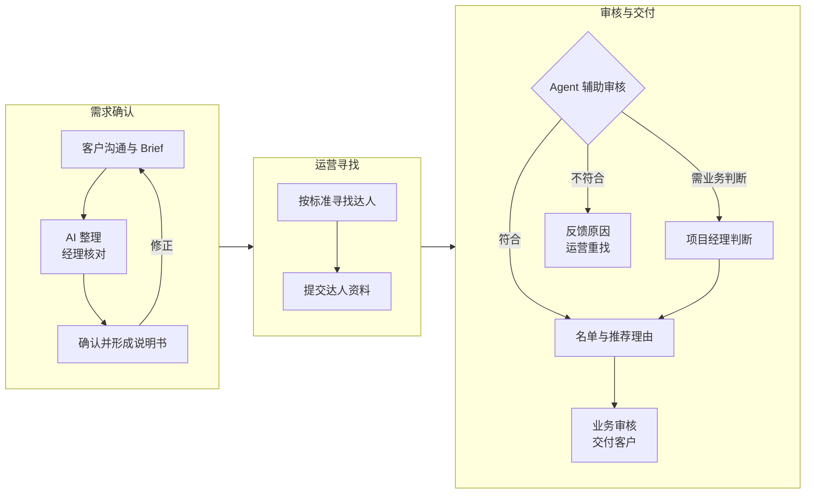
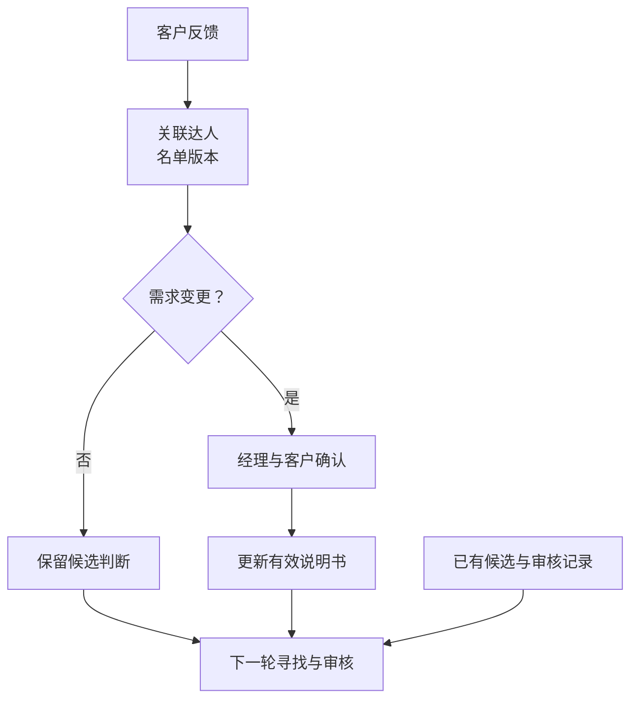

# 达人营销：让寻找、审核和名单交付使用同一份标准

项目时间：2026 年 7 月

达人营销项目通常从客户的一份 Brief 开始。运营根据要求寻找达人，查看主页和内容，再整理名单交给项目经理审核。但客户的描述并不总能直接变成寻找条件，平台标签也不足以判断某位达人是否符合业务要求。

需求没有被澄清时，寻找和审核可能使用不同的判断依据。运营花时间整理了一批候选人，名单交上来以后才发现理解存在偏差；客户的反馈又散在群聊和不同版本的名单里，下一轮寻找需要重新解释要求。

我围绕需求确认、运营寻找、候选审核和名单反馈梳理流程，探索 AI 在需求理解与内容核验中的作用。项目的核心是让各个角色使用同一份确认过的标准，并让审核结果能够帮助下一轮寻找。

## 客户确认是寻找工作的起点

我将客户沟通和运营执行之间的交接落实为一份《达人寻找说明书》。项目经理在业务群中对接客户，AI 辅助整理需求文档；项目经理核对后交客户确认，再形成说明书并交给该项目的运营人员。

客户确认后的要求同时服务于寻找和审核。运营知道按什么条件提交，审核也有可以对照的依据。遇到模糊候选或商业判断时，由项目经理处理，对客名单由业务人员确认。

## 让不通过的原因也成为有用的交付信息

候选人通过审核时，清单需要保留推荐理由；不通过时，也需要反馈具体原因。运营据此调整下一次提交，项目经理则能够解释名单的选择逻辑。

我同时梳理了达人去重、历史评估和反馈整理需要使用的信息，将客户、项目、当前 Brief、候选人、名单版本和反馈关联起来。

这一关联让反馈能够回到对应对象。一位达人被拒绝，首先是对这个候选人的判断；只有客户要求发生变化并完成确认，才更新有效标准。运营和审核环节因而能够沿用同一份要求。

最终交付的流程连接了客户确认、运营执行与 Agent 辅助审核，也明确了名单和反馈需要保留的上下文。寻找、审核与名单调整之间有了共同依据，项目经理能够把注意力集中到需求澄清、业务判断和对客交付上。

