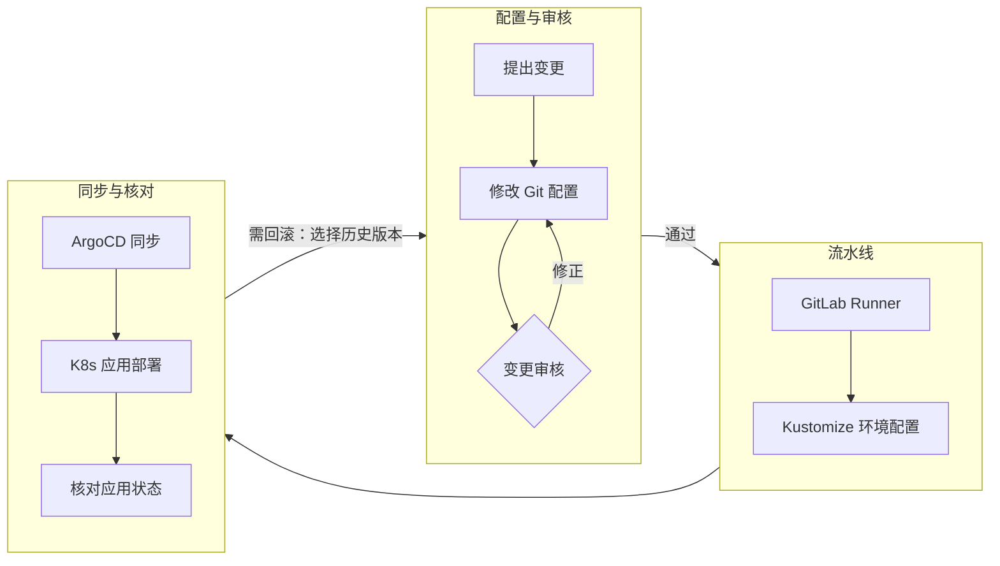
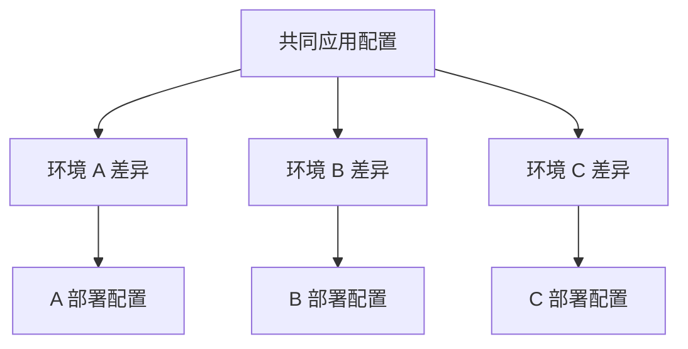

# 企业级 GitOps 发布平台建设：让多环境发布围绕同一份配置推进

项目时间：2022 年 12 月

公司向云原生架构转型后，原有发布方式需要适应 Kubernetes 环境。应用在多个环境中部署，配置版本、环境差异和人工操作都影响着变更进入运行环境的速度与稳定性。

一次发布需要回答几个相互关联的问题：采用哪一份配置，环境差异是否正确，变更由谁审核，出现问题时能够回到哪个版本。如果这些信息分别由人维护，团队就需要在发布过程中反复核对。

我负责设计和建设 GitOps 发布平台，将配置管理、多环境模板、自动发布、审核与回滚组织成连贯的交付流程。

## 让发布有明确的版本依据

我将基础设施与应用配置纳入 Git 管理，保留配置变更和版本。发布围绕明确版本推进，审核能够查看变更内容，问题定位和回滚也有对应依据。

GitLab Runner、Kustomize 与 ArgoCD 共同组成发布平台：流水线承接执行步骤，Kustomize 组织环境配置，ArgoCD 衔接配置同步与应用部署。

图中展示的是整体发布关系。版本标识连接配置变更和应用状态，团队在排查发布问题时能够沿着这条关系核对，而回滚也通过共同的变更流程处理。

## 保留必要差异，同时减少重复配置

多个环境既有共同配置，也有各自的要求。共同部分如果反复复制，修改时就需要分别维护；环境差异如果表达不清，又容易带来配置错误。

我使用 Kustomize 组织多环境配置，制定模板与审核规范，将共同部分与环境差异明确区分并纳入版本管理。

这样，审核既能核对共同配置的变更，也能看清特定环境的差异。模板为团队提供一致的组织方式，必要差异仍能被明确表达。

## 把工具链和使用方法一起交付

我制定最佳实践、配置规范和使用文档，并指导开发及运维团队采用共同的审核、发布和回滚流程。平台中的工具与团队的协作方式共同构成了交付。

最终，应用变更从配置修改到进入 Kubernetes 环境，有了明确的版本依据和执行路径。多环境配置能够按模板维护，审核、发布状态和回滚围绕相应版本关联，团队可以按同一套方法持续开展日常发布。

