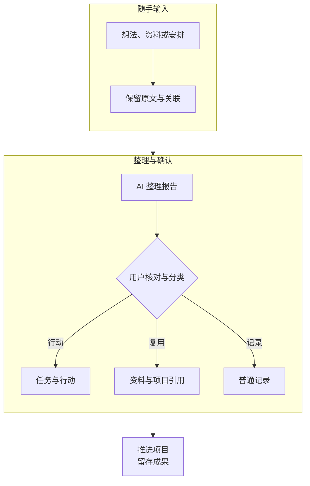
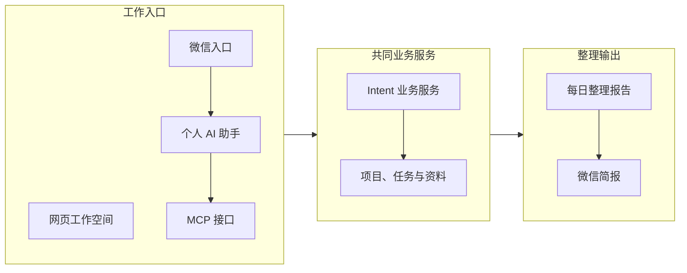

# Intent：让对话里的想法接到实际行动

项目时间：2026 年 10 月

使用 AI 工作时，我遇到一个反复出现的问题：讨论中产生了想法和决定，对话结束后，它们散在聊天记录、待办工具和文件里。重新推进同一个项目，需要再找资料、解释背景，并整理下一步要做什么。

AI 可以帮助完成眼前的一项任务，但目标、判断、材料和成果之间的关系，仍然需要个人持续维护。这部分整理工作消耗注意力，也容易让已经讨论过的事情失去后续。

我因此自主设计并开发了 Intent，把记录、项目、任务、资料和行动连接到同一个工作空间，并接入个人 AI 助手和微信入口，使不同入口中的工作能够使用同一份业务数据。

## 一句话先被保存，再决定它应该成为什么

随手输入的内容，可能是想法、参考资料，也可能是一项明确任务。直接把所有内容放进待办列表，会让普通记录和需要执行的事情混在一起。

我在产品中区分原始记录与正式对象。先保留输入，再由 AI 形成整理报告和建议。用户可以查看依据、修正分类，通过确认形成项目、任务或资料；普通记录继续保留原有形态。

这个设计保留了用户对目标和优先级的决定权。AI 帮助组织信息，正式的任务和安排由用户确认，输入本身也能够被回看。

## 让网页和助手围绕同一个项目工作

网页以项目、近期资料和今日安排为主要入口。项目连接任务、资料与成果，相关操作放在对象附近，使用户能够从正在推进的事情继续。

如果网页和助手分别维护数据，个人又需要在两个入口之间重复保存和同步。我实现了共同的业务服务与 MCP 接口，让网页和 Agent 查询、操作相同的对象。

MCP 在这里承担助手访问产品业务能力的接口作用，网页和助手通过相同的服务获取与操作项目对象。工作入口可以不同，项目的任务、资料和状态则由产品统一维护。

我还交付了每日整理报告、微信简报，以及关注、运行事件和通知状态等基础能力，将随手记录、阶段整理和后续操作放进同一套产品结构。

Intent 最终形成了网页工作空间、业务服务、助手接口和整理报告的整体交付。分散的输入能够关联到项目，任务和成果也有了共同的存放与操作位置，为个人持续推进工作提供了具体载体。

