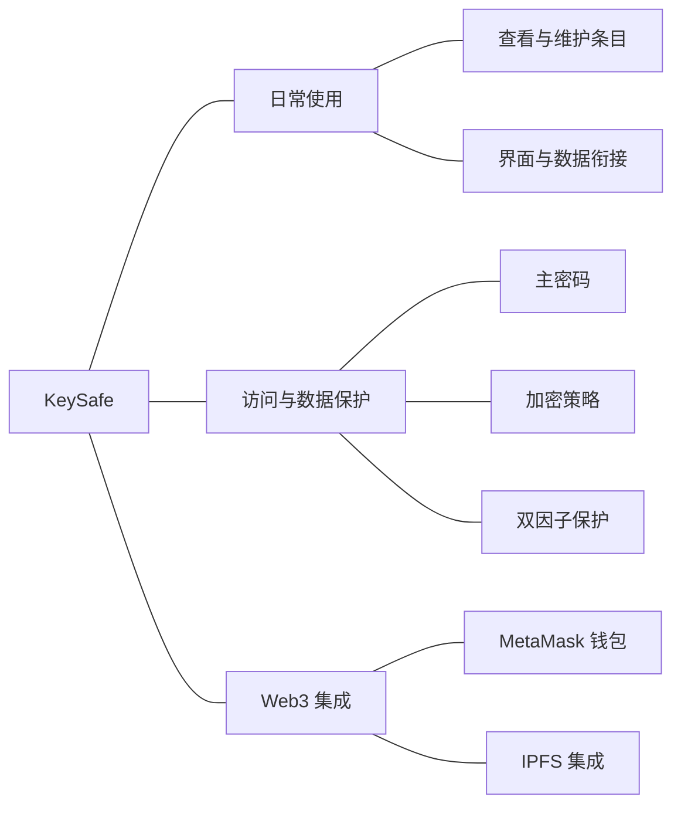
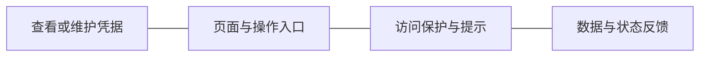

# KeySafe：把密码管理体验与保护机制放进同一个产品

项目时间：2024 年 12 月

密码管理工具需要帮助用户保存、查看和维护凭据，也需要考虑凭据在保存与访问过程中的保护。用户体验与保护机制彼此关联：操作流程需要能够被理解，技术机制也需要与实际动作衔接。

KeySafe 围绕去中心化密码管理展开，探索 Web3 能力与日常产品体验的结合。我以全栈开发角色参与产品界面、数据管理和 Web3 集成，使不同组件围绕密码管理任务协同工作。

## 从用户操作出发连接界面与数据

用户在界面中查看或维护密码条目，背后需要有相应的数据处理逻辑。页面显示什么、操作会改变什么，以及完成操作后如何反馈，都需要前后端一起考虑。

我使用 Next.js、React、TypeScript 和 Ant Design 参与前端开发，并结合 PostgreSQL 处理数据管理。产品同时涉及 MetaMask、IPFS 等集成技术，将钱包与去中心化相关能力纳入整体开发工作。

下面按产品能力组织关系，说明这个项目中需要共同考虑的内容。

这些能力共同服务于用户任务。界面承担条目操作和反馈，数据管理承接相应状态，保护与集成机制则需要进入能够理解的使用流程。

## 将保护要求落实到产品交互

项目设计包含主密码、多重加密策略和双因子保护。设计交互时，需要说明当前操作的含义、需要完成的验证，以及完成后可以继续进行的动作。

这类产品还需要把身份确认、凭据访问和条目维护之间的关系讲清楚，避免用户只能看到技术名称，却不知道如何完成自己的任务。我在参与开发时，将这些要求与界面和数据逻辑一起考虑。

图中呈现的是产品任务与开发关注点的关系。钱包接入、保护机制和条目操作需要围绕共同的使用目的组织，具体技术组件也因此有明确的产品职责。

项目交付包含密码管理界面、数据管理和 Web3 集成工作，并形成演示与文档。开发过程跨越前端、后端和外部组件，将密码管理方向落实到能够查看和操作的产品中。

