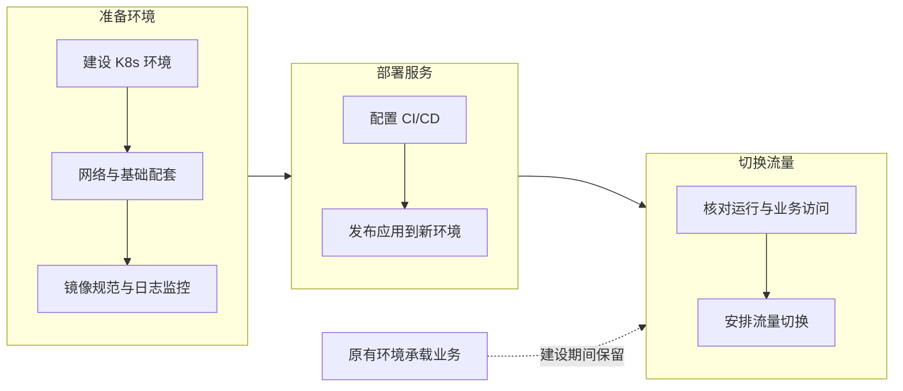
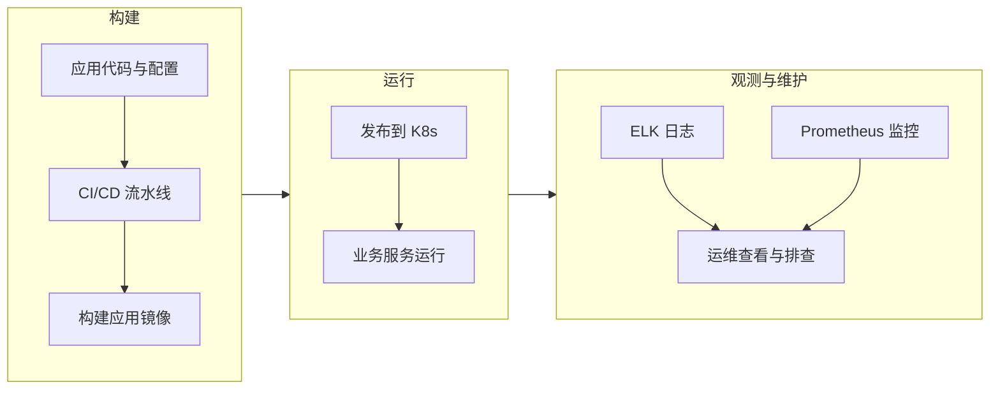
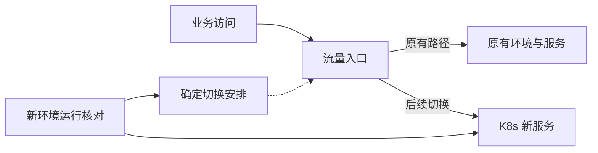

# 企业级容器平台建设与应用迁移

项目时间：2021 年 12 月

随着业务规模扩大，原有虚拟机部署方式暴露出资源利用率低、环境差异和重复维护的问题。团队希望建设统一的容器运行环境，让应用能够通过共同的方式部署和维护。

这个项目从新的 Kubernetes 环境开始建设，原有基础设施可以继续承载业务。实施路径是先搭建集群和基础配套，再配置 CI/CD，将服务发布到新环境，最后安排流量切换。

我负责平台架构与建设、镜像流水线、日志监控体系，并制定应用改造规范，指导开发团队推进容器化。建设新平台与承接线上流量因此可以分开推进。

## 先把新环境和发布路径准备好

我设计并部署生产级 Kubernetes 集群，完成多可用区高可用架构和网络方案选型，为业务应用提供共同的运行基础。

集群之外，应用构建、环境配置和运行观测也需要有明确的方法。我建设镜像流水线，规范基础镜像制作与容器化流程，同时基于 ELK 和 Prometheus 建设日志采集、监控和告警体系。

这些配套让服务进入集群后能够被发布、观察和维护。CI/CD 将代码构建与应用部署连接起来，团队可以通过共同路径把服务发布到新环境。

这条路径把平台准备、应用部署与流量切换区分开。新环境的服务可以先完成部署和运行核对，线上业务仍由原有环境承载。

## 应用进入平台以后，仍要能够维护

我制定应用容器化规范，并指导开发团队完成相应改造。开发团队按共同规范准备应用，流水线承担构建和发布，Kubernetes 提供运行环境。

日志和监控随应用一起接入，使运维团队在新的运行方式下仍能查看状态、接收告警和排查故障。镜像、发布与观测的规范也为后续接入应用提供共同基础。

## 服务部署与流量切换分别推进

原有环境保留，使平台建设不必与线上流量切换同时发生。新环境部署就绪后，再根据服务情况安排业务访问切换。

切换前需要核对的不只是服务能否启动，还包括业务访问、依赖连接、配置和日志监控是否能够支持运行。涉及持久化数据的服务，还需要明确数据读写关系，确保流量切换与数据状态衔接。这些都是安排切换时需要考虑的工程条件。

这里展示的是新旧环境与流量入口的关系。保留原有基础设施，为准备新环境和安排切换留出了独立的实施空间。

项目交付连接了生产级集群、基础配套、镜像与 CI/CD、应用改造、日志监控和流量切换安排。业务应用有了共同的构建与运行路径，平台建设也能够在原有业务继续运行的条件下推进。

