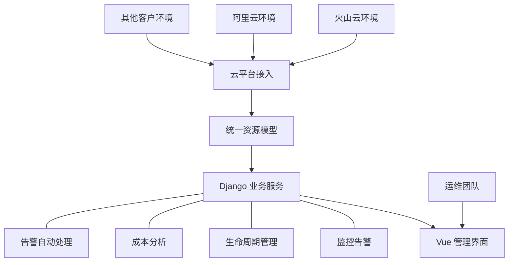
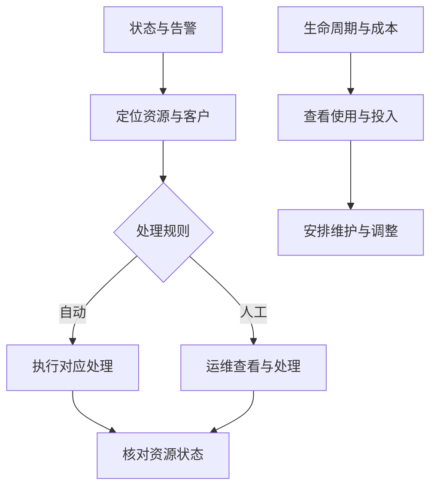

# 多云资源管理平台：让分散的客户环境进入同一个运维入口

项目时间：2024 年 6 月

公司承接多个客户的私有化部署项目，不同客户使用不同的云服务提供商。资源查看、监控和操作分散在各个平台中，运维团队需要跨环境寻找资源，再汇总状态并开展维护。

资源规模扩大以后，平台切换与信息汇总成为持续性的负担。一台主机属于哪个客户、运行情况怎样、是否存在告警，以及资源投入是否合理，都需要有清楚的关联。

我主导建设多云资源管理平台，负责整体架构、前后端开发与客户环境接入，让团队围绕同一套资源信息开展日常维护。

## 统一入口先要有共同的数据基础

不同云平台的资源需要被组织到一致的模型中，后续监控、操作和成本分析才能围绕相同的对象展开。我设计了统一多云资源管理模型，对接火山云、阿里云等环境，并将资源按客户、环境与归属组织起来。

平台采用 Vue 与 Django 的前后端分离架构。前端提供集中查看与操作，后端承接资源对象、平台接入和管理逻辑，使不同环境的资源能够在共同入口中被管理。

这套关系使平台能够回答资源在哪里、属于谁、状态怎样，以及可以开展哪些维护工作。统一模型也为各个管理模块提供共同的关联基础。

## 从发现问题到开展维护

只有资源清单，还不足以承接日常运维。我继续实现监控告警、生命周期管理、成本分析和告警自动处理模块，让资源状态能够连接到后续动作。

资源状态、告警和成本信息围绕同一对象组织，团队能够在处理问题时找到资源归属，也能结合实际使用情况查看投入。自动处理与人工维护分别承接适合的工作。

平台接入客户实际使用的云环境，使集中查看和管理进入日常维护。最终交付覆盖统一资源模型、管理界面、运维能力与环境连接，让分散在不同云平台中的工作有了共同入口，也为持续接入客户环境提供了基础。

