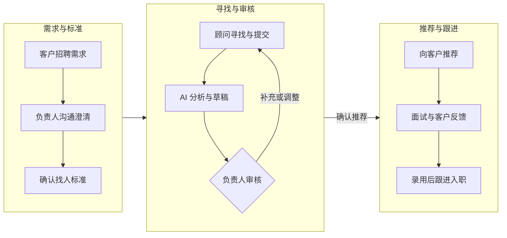
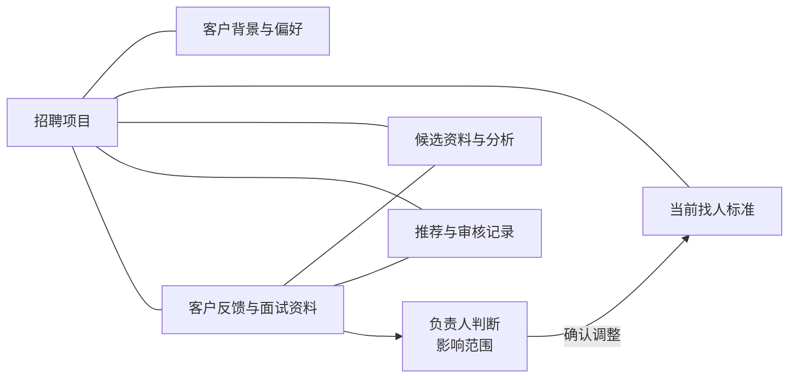

# 猎头招聘：让找人标准贯穿整个交付过程

项目时间：2026 年 9 月

一项猎头招聘交付，会从客户提出需求持续到候选人入职。其间既要理解客户真正需要什么人，也要让交付顾问沿着相同的标准寻找候选人，并根据面试与反馈调整方向。

随着候选人增加，项目中的判断也不断积累：哪些经历真正重要，哪些条件可以放宽，客户为什么拒绝了上一个人选。这些信息如果主要保存在项目负责人的记忆中，团队每次开展分析和推荐，就需要重新解释背景。

即使 AI 已经能够辅助分析简历，负责人仍要准备材料、说明要求、发起任务，再把分析结果接到下一步工作中。我围绕这条招聘链路梳理流程，定义任务能力并设计共享项目档案，让各项分析围绕同一个招聘项目开展。

## 先把角色和交接关系讲清楚

我从客户沟通、需求拆解、候选人寻找、推荐、面试和入职等业务环节出发，明确每一步需要的材料、产出和审核者。

项目负责人负责理解需求、确认标准、审核推荐并对接客户；交付顾问负责寻找、沟通和提交候选人，承接录用沟通与入职跟进。AI 辅助整理资料、分析匹配情况和形成草稿，关键业务判断保留给负责人。

这条流程中，推荐草稿需要交给负责人审核，客户反馈也需要经过业务判断再影响寻找方向。AI 的分析与人的决定有明确的衔接位置。

## 让下一次判断能够利用前面的经验

招聘标准会随着客户沟通变得更具体。我设计了共享项目档案，将客户背景、当前找人标准、候选人资料、推荐记录和客户反馈关联起来，使一次新分析能够读取相关背景。

一条拒绝反馈需要保留它对应的候选人、岗位和原因。拒绝某个人，可能只涉及这个人的经历，也可能意味着整个寻找方向需要调整。先保留关联，再由负责人作出判断，可以避免把一次局部反馈直接套用到所有后续人选。

在能力拆解上，我定义了需求预研、访谈准备、会议纪要、客户档案、找人标准、简历评估、推荐材料、面试报告和复盘九类任务。每类任务都明确输入、产出和审核职责，使需求、分析与推荐之间有可以执行的交接规则。

## 交付怎样承接到团队工作中

项目交付包括招聘工作流、九类任务能力定义和共享项目档案方案。负责人可以围绕同一份标准审核分析，交付顾问也能根据反馈继续寻找，已有判断成为后续工作的依据。

项目中的整理与协调用时减少 40%，分析返工次数减少 30%，任务衔接等待时间减少 50%。这些变化对应着实际工作中的三类负担：重复准备材料、重复修正分析，以及等待下一步交接。

