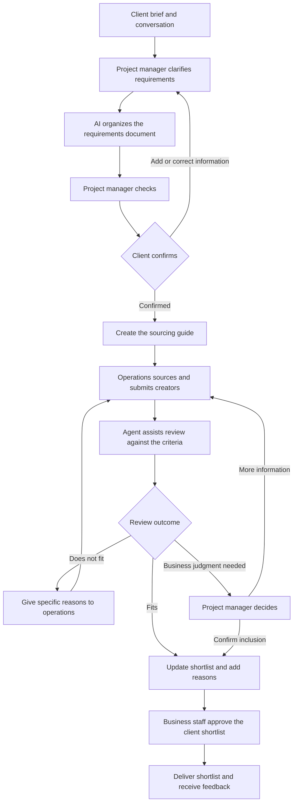
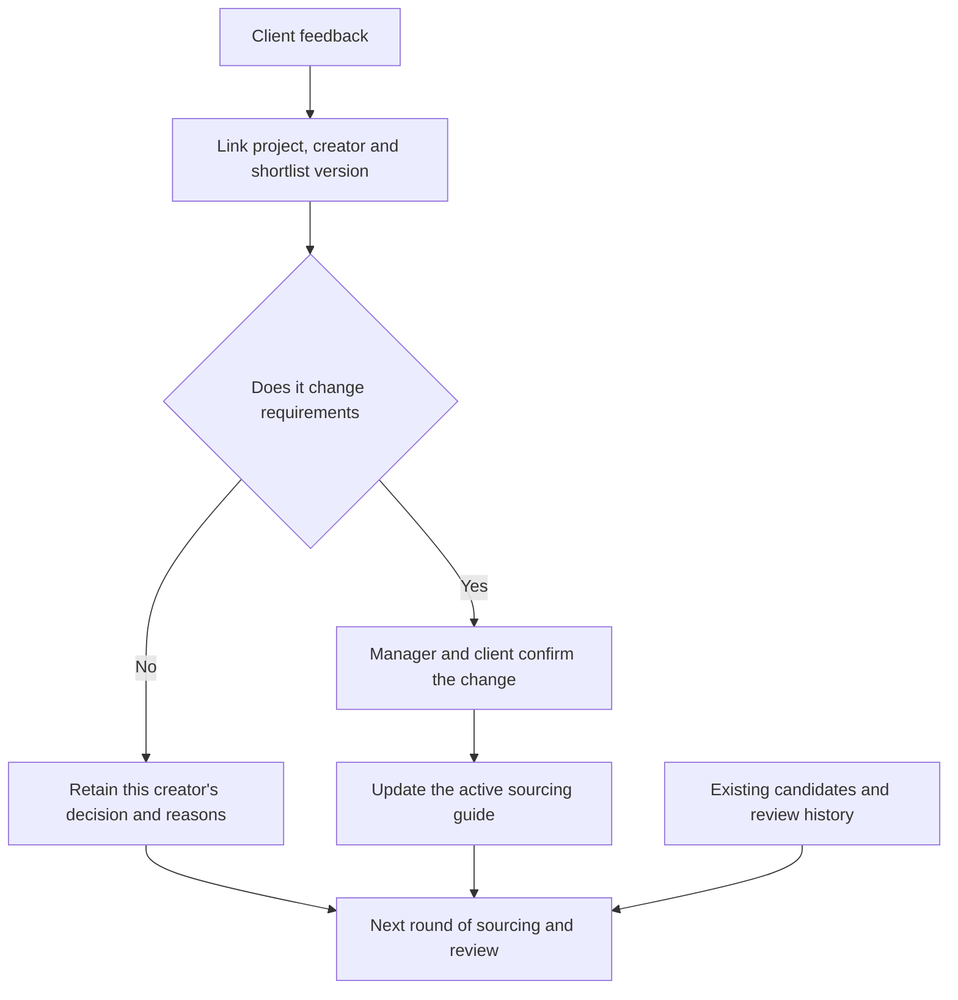

# Creator Marketing: Shared Criteria for Sourcing, Review and Shortlist Delivery

Project date: July 2026

Creator marketing usually starts with a client brief. Operations staff source creators, examine their profiles and content, then prepare a shortlist for the project manager. A client's description does not always translate directly into sourcing criteria, and platform labels alone are insufficient for judging business fit.

Without clarification, sourcing and review can use different criteria. Staff spend time preparing candidates only to discover a misunderstanding when the shortlist is reviewed. Feedback is scattered across conversations and shortlist versions, so the next round requires the requirements to be explained again.

I analyzed the workflow from requirements confirmation through sourcing, candidate review and shortlist feedback, and explored AI assistance for interpreting requirements and checking content. The central aim is for each role to work from confirmed criteria and for review results to inform the next search.

## Client confirmation starts the sourcing process

I made the handoff between client communication and operational work concrete through a creator sourcing guide. The project manager communicates with the client in the business group, while AI helps prepare a requirements document. After the manager checks it and the client confirms it, the guide goes to the project's operations staff.

Confirmed requirements serve both sourcing and review. Operations knows what to submit, and reviewers have explicit criteria. The project manager handles ambiguous candidates and commercial judgments; business staff approve the shortlist sent to the client.

## Making rejection reasons useful to the next round

Accepted candidates retain their recommendation reasons. Rejected candidates also receive specific explanations. Operations can adjust the next submission, and the project manager can explain how the shortlist was selected.

I also organized the information needed for deduplication, previous assessments and feedback, linking the client, project, active brief, candidates, shortlist versions and responses.

Feedback returns to the object it concerns. Rejecting one creator is initially a decision about that candidate; the active criteria change only after a change in client requirements is confirmed. Operations and reviewers can therefore continue using the same requirements.

The delivered workflow connects client confirmation, operational sourcing and agent-assisted review, and defines the context retained with shortlists and feedback. Sourcing, review and shortlist revisions share a common basis, helping the project manager focus on clarification, business judgment and client delivery.

