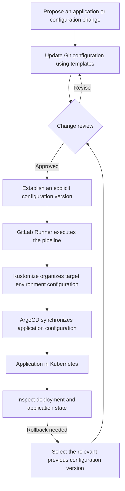
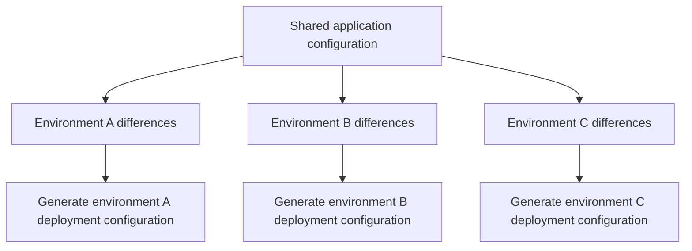

# Enterprise GitOps Delivery: Deploying Across Environments from Versioned Configuration

Project date: December 2022

As the company adopted cloud-native architecture, its release process needed to support Kubernetes. Applications were deployed into multiple environments, with configuration versions, environment differences and manual operations affecting deployment speed and reliability.

A release needs to answer related questions: which configuration it uses, whether environment differences are correct, who reviews the change and which version can be restored if needed. When people maintain those details separately, each deployment requires repeated coordination and checks.

I designed and built a GitOps delivery platform connecting configuration management, environment templates, automated deployment, review and rollback into one workflow.

## Giving deployment a versioned basis

I put infrastructure and application configuration under Git version control. Releases use explicit configuration versions, reviewers can inspect changes, and troubleshooting and rollback have corresponding references.

GitLab Runner, Kustomize and ArgoCD form the delivery platform: pipelines handle execution steps, Kustomize organizes environment configuration, and ArgoCD connects configuration synchronization to application deployment.

The diagram shows the overall deployment relationships. Version identifiers connect configuration changes to application state, giving the team a path for checking release problems. Rollback follows the shared change process as well.

## Keeping necessary differences while reducing duplication

Environments share configuration but also have distinct requirements. Copying the common parts means maintaining each copy; poorly expressed differences can cause configuration errors.

I used Kustomize to organize environment configuration and defined templates and review standards so shared configuration and environment-specific differences are explicit and versioned.

Reviewers can check both common changes and the differences specific to a target environment. Templates provide a consistent organization method while preserving necessary variation.

## Delivering both the toolchain and its working practices

I prepared best practices, configuration standards and usage documentation, and guided development and operations teams in adopting shared review, deployment and rollback workflows. The tools and the team's working practices together form the deliverable.

Application changes now have explicit version references and execution paths from configuration edits to Kubernetes. Environment configuration is maintained through templates, while review, deployment state and rollback are associated with relevant versions, giving the team a shared method for daily releases.

