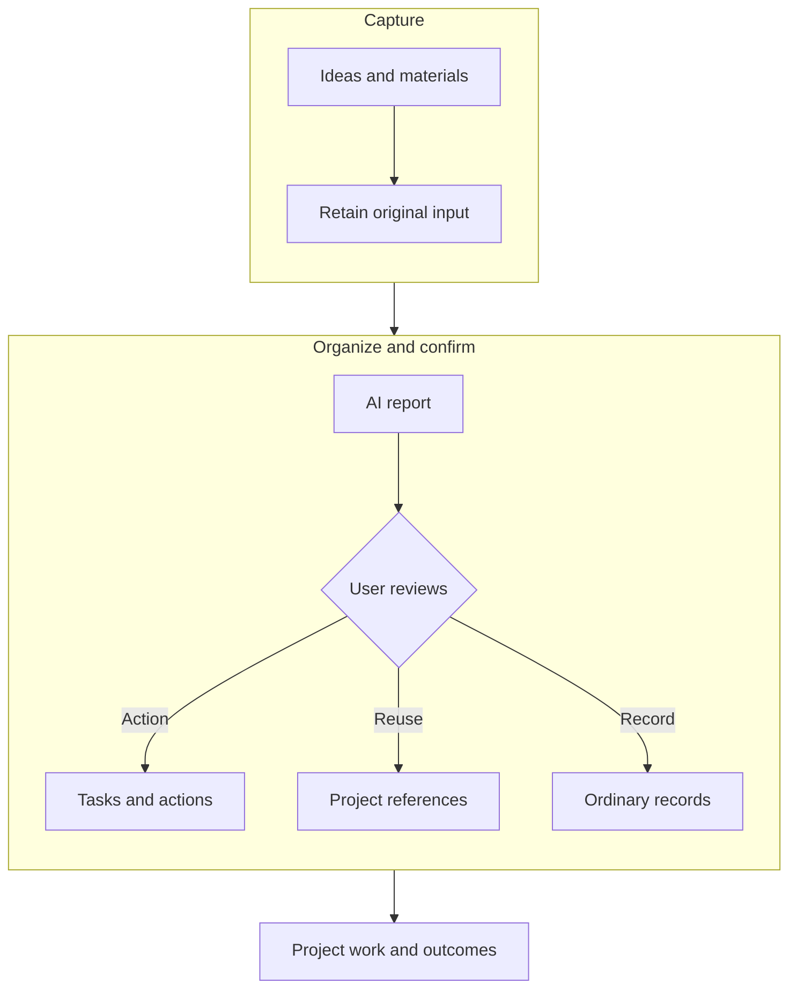
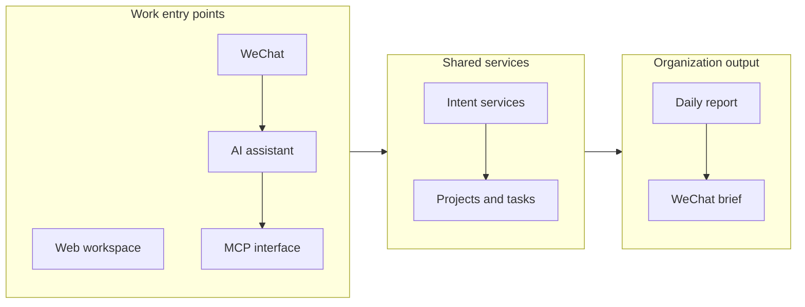

# Intent: Connecting Ideas in Conversations to Action

Project date: October 2026

While working with AI, I repeatedly encountered the same problem: conversations produced ideas and decisions, but afterward they were scattered across chats, task tools and files. Returning to a project meant finding materials, explaining the background again and organizing what to do next.

AI can help with an immediate task, while the relationships between goals, judgments, materials and outcomes still require ongoing personal maintenance. That work consumes attention and can leave previously discussed ideas without a next step.

I independently designed and developed Intent to connect records, projects, tasks, materials and actions in one workspace. I also integrated my personal AI assistant and a WeChat entry point so work through different interfaces could use the same business data.

## Saving an input before deciding what it should become

A quick input can be an idea, reference material or a concrete task. Sending everything directly to a task list mixes ordinary records with work that requires execution.

I separated original records from formal objects. The product retains the input before AI creates an organization report and suggestions. Users can inspect the reasoning, correct classifications and confirm projects, tasks or materials; ordinary records retain their original form.

The design preserves the user's decisions about goals and priorities. AI organizes information, users confirm formal tasks and plans, and the original input remains available to revisit.

## Bringing the website and assistant into the same project

The web workspace centers on projects, recent materials and today's plans. Projects connect tasks, materials and outcomes, with related actions close to the objects they concern, so users can continue their current work.

If the website and assistant maintained separate data, users would again need to save and synchronize it twice. I implemented shared business services and MCP interfaces so both the web interface and the agent query and operate on the same objects.

MCP provides the assistant's interface to product capabilities. The website and assistant use the same services to access and operate on project objects. Work can start through different entry points while the product maintains the relationships between project tasks, materials and state.

I also delivered daily organization reports, WeChat briefs and foundational capabilities for attention, execution events and notification state, bringing quick capture, periodic organization and subsequent operations into one product structure.

Intent combines a web workspace, business services, assistant interfaces and organization reports. Scattered inputs can be associated with projects, while tasks and outcomes have a common place to be stored and operated on, providing a concrete workspace for continuing personal work.

