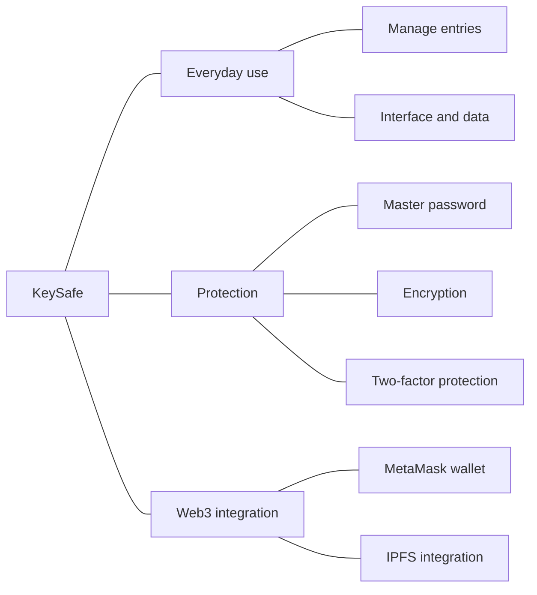
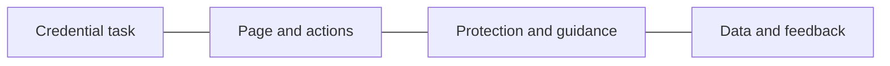

# KeySafe: Bringing Password Management and Protection into One Product

Project date: December 2024

A password manager needs to help users save, view and maintain credentials while considering protection during storage and access. Usability and protection are connected: the flow needs to be understandable, and technical mechanisms need to fit actual user actions.

KeySafe explores decentralized password management and the combination of Web3 capabilities with everyday product experiences. As a full-stack developer, I contributed to the interface, data management and Web3 integration, connecting components around password management tasks.

## Connecting the interface and data around user actions

Viewing or maintaining a credential requires corresponding data processing. What a page displays, what an action changes and how completion is communicated need to be considered across frontend and backend.

I used Next.js, React, TypeScript and Ant Design for frontend work and PostgreSQL for data management. The product also involved integrations such as MetaMask and IPFS, bringing wallet and decentralized capabilities into the overall development work.

The following diagram organizes the product capabilities and the concerns that need to be considered together.

These capabilities serve shared user tasks. The interface handles entry operations and feedback, data management handles the corresponding state, and protection and integration mechanisms need to fit an understandable flow.

## Reflecting protection requirements in product interactions

The design includes a master password, multiple encryption strategies and two-factor protection. Interaction design needs to explain what an action means, what verification it requires and what the user can do afterward.

The product also needs to clarify the relationships between identity confirmation, credential access and entry maintenance so users can complete their tasks. I considered those requirements alongside the interface and data logic during development.

The diagram connects product tasks to development concerns. Wallet integration, protection mechanisms and entry operations are organized around the same purpose, giving technical components concrete product responsibilities.

The deliverables include the password management interface, data management and Web3 integration, along with a demonstration and documentation. The work spans frontend, backend and external components, turning the password management direction into a product people can view and operate.

