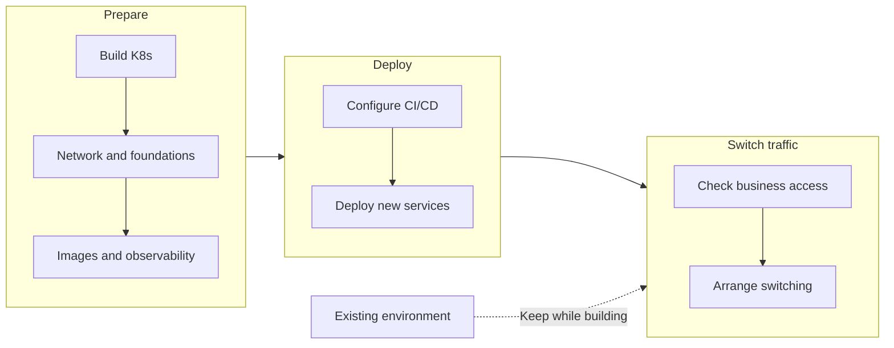
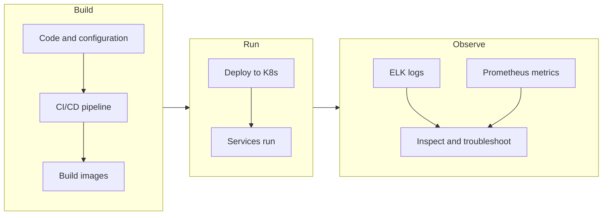
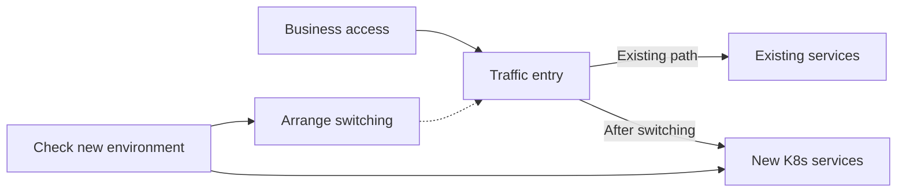

# Enterprise Container Platform and Application Migration

Project date: December 2021

As the business expanded, virtual-machine deployment exposed low resource utilization, environment differences and repeated maintenance work. The team wanted a shared container environment so applications could be deployed and maintained through common methods.

The project started by building a new Kubernetes environment while the existing infrastructure continued serving the business. The sequence was to prepare the cluster and supporting infrastructure, configure CI/CD, deploy services into the new environment and arrange traffic switching afterward.

I was responsible for platform architecture and implementation, image pipelines, logging and monitoring. I also defined application migration standards and guided the development team through containerization, allowing platform construction and live traffic switching to progress separately.

## Preparing the environment and deployment path first

I designed and deployed a production Kubernetes cluster, including a highly available architecture across availability zones and network selection, to provide a shared runtime for business applications.

The cluster also needed clear methods for builds, configuration and runtime visibility. I built image pipelines, standardized base images and containerization, and implemented logging, monitoring and alerting with ELK and Prometheus.

These supporting capabilities make services deployable, observable and maintainable after entering the cluster. CI/CD connects application builds to deployment, giving the team a shared path into the new environment.

The sequence separates platform preparation, application deployment and traffic switching. Services can be deployed and checked in the new environment while existing infrastructure continues handling live business traffic.

## Maintaining applications after they enter the platform

I defined containerization standards and guided the development team through the changes. Developers prepare applications using common standards, pipelines handle builds and releases, and Kubernetes provides the runtime.

Logging and monitoring are connected alongside the applications so operations staff can inspect state, receive alerts and investigate failures in the new runtime. Image, deployment and observability standards also provide a shared basis for bringing in later applications.

## Deploying services and switching traffic separately

Retaining the existing environment allows platform construction to progress independently of live traffic switching. Once services are deployed in the new environment, business access can be switched according to service conditions.

Before switching, the checks need to cover business access, dependencies, configuration, logs and monitoring as well as service startup. Services using persistent data also need clear read and write relationships so traffic changes align with data state. These are engineering conditions to consider when arranging the switch.

The diagram relates the old and new environments to the traffic entry point. Retaining the existing infrastructure creates room to prepare the new environment and arrange the switch as separate implementation steps.

The deliverables connect the production cluster, supporting infrastructure, images and CI/CD, application changes, logging and monitoring, and traffic switching arrangements. Applications have a shared build and runtime path, while platform construction can proceed with the existing business still operating.

