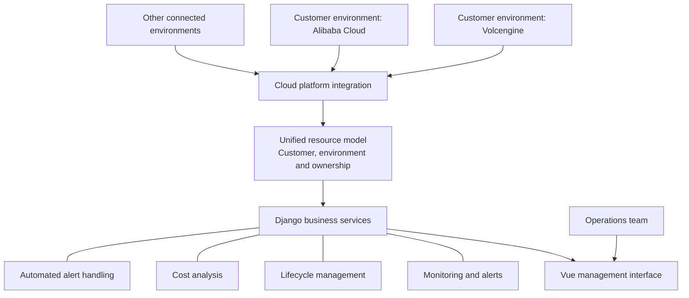
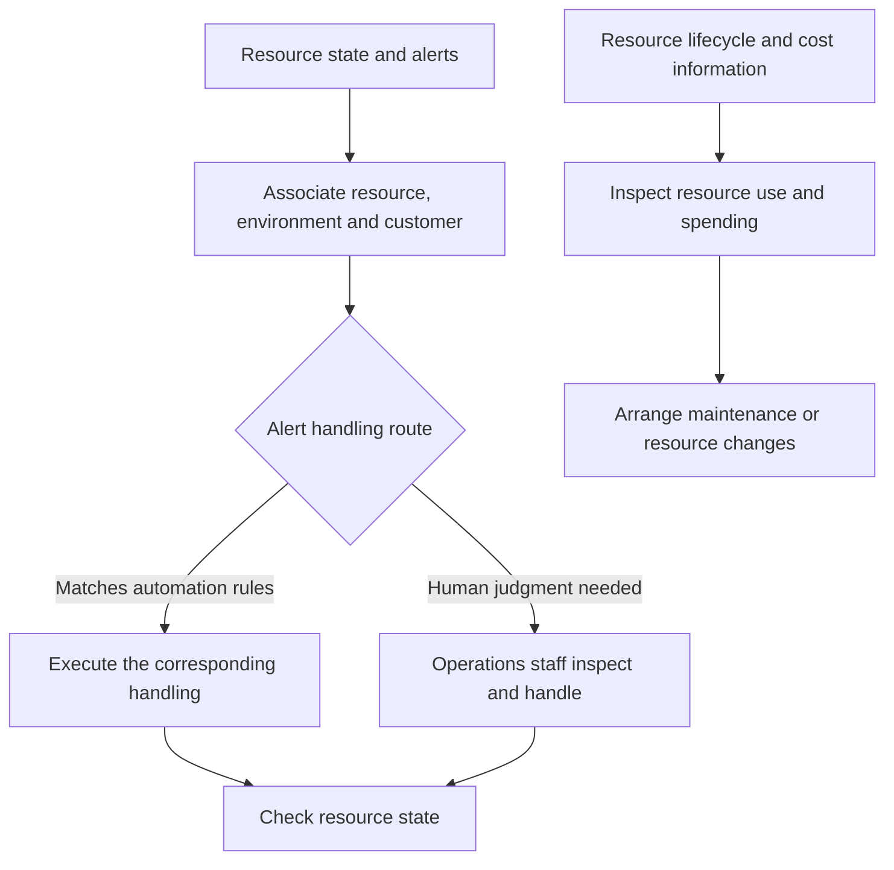

# Multi-Cloud Resource Management: One Operations Entry Point for Customer Environments

Project date: June 2024

The company delivered private deployments for multiple customers using different cloud providers. Resource views, monitoring and operations were scattered across platforms, so the operations team had to find resources in each environment before assembling status information and carrying out maintenance.

As resource numbers grew, switching platforms and consolidating information became recurring work. The team needed clear relationships between a machine, its customer, its running state, its alerts and its resource cost.

I led the platform architecture, frontend and backend development, and customer environment integration, giving the team a shared resource information model for daily operations.

## A common data foundation for a shared entry point

Resources from different providers need a consistent model so monitoring, operations and cost analysis can concern the same objects. I designed a unified multi-cloud resource model, connected environments including Volcengine and Alibaba Cloud, and organized resources by customer, environment and ownership.

The platform uses a Vue frontend and Django backend. The frontend provides a consolidated view and operations, while the backend handles resource objects, provider integration and management logic, making resources from different environments accessible through a shared interface.

The relationships help answer where a resource is, who it belongs to, how it is running and which maintenance actions concern it. The unified model also gives management modules a common basis for associating information.

## Connecting detected problems to maintenance

A resource inventory alone does not cover daily operations. I implemented monitoring, alerts, lifecycle management, cost analysis and automated alert handling so resource state connects to subsequent work.

State, alerts and costs are organized around the same resource. Staff can locate ownership when handling a problem and examine spending alongside usage. Automated handling and human maintenance take on the work appropriate to each.

The platform connected real customer cloud environments, bringing consolidated resource management into daily maintenance. The delivered model, interface, operations capabilities and integrations provide a shared entry point for work previously spread across cloud platforms, as well as a foundation for connecting additional customers.

