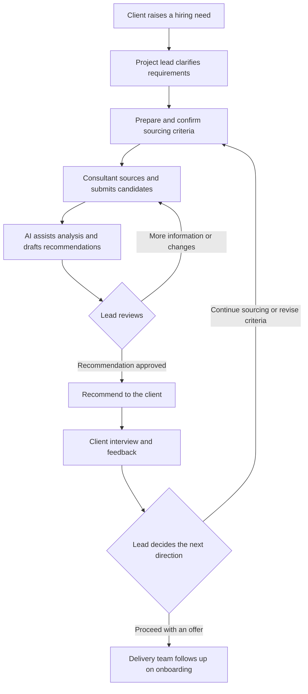
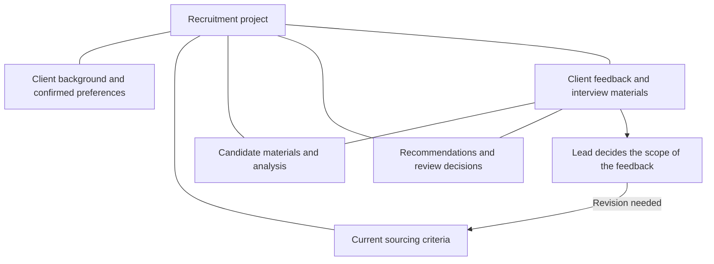

# Executive Search: Keeping Hiring Criteria Consistent Throughout Delivery

Project date: September 2026

An executive search engagement runs from understanding a client's requirements to a candidate joining the company. Throughout that process, the team needs to understand whom the client really wants, source against shared criteria and adjust direction using interview feedback.

As candidates are reviewed, the project accumulates judgments: which experience matters, which requirements can be relaxed and why the client rejected a previous candidate. When this knowledge primarily lives in the project lead's memory, each new analysis or recommendation requires the background to be explained again.

Even when AI can help assess a resume, the lead still prepares materials, explains requirements, starts tasks and hands results to the next person. I analyzed the recruitment workflow, defined task capabilities and designed shared project records so those activities could use the same recruitment context.

## Making roles and handoffs explicit

I worked through client conversations, requirements analysis, sourcing, recommendations, interviews and onboarding to define each step's inputs, outputs and reviewer.

The project lead understands requirements, confirms criteria, approves recommendations and communicates with the client. Delivery consultants source and communicate with candidates, submit materials and follow up on offers and onboarding. AI helps organize information, assess matches and produce drafts; the lead retains the key business decisions.

Recommendation drafts are reviewed by the lead. Client feedback also goes through a business decision before it changes the sourcing direction. AI analysis and human decisions have explicit handoff points.

## Carrying earlier judgments into the next assessment

Hiring criteria become more specific through client conversations. I designed shared project records linking client background, current sourcing criteria, candidate materials, recommendations and feedback so a new assessment can read the relevant context.

A rejection needs to retain the candidate, role and reason it concerns. It may apply only to one person's experience, or it may indicate that the broader search direction should change. Preserving the relationships before asking the lead to decide helps avoid applying one local judgment to every later candidate.

I defined nine task capabilities: requirements research, interview preparation, meeting notes, client profiles, sourcing criteria, resume assessment, recommendation materials, interview reports and project retrospectives. Each has specified inputs, outputs and review responsibilities, giving requirements, analysis and recommendations actionable handoff rules.

## Connecting the deliverables to team operations

The deliverables include the recruitment workflow, definitions for nine task capabilities and the shared project-record design. The lead can review analysis against shared criteria, while consultants can use feedback to continue sourcing. Earlier judgments become usable context for later work.

Organization and coordination time decreased by 40%, analysis rework decreased by 30%, and time waiting for task handoffs decreased by 50%. These changes address three practical burdens: repeatedly preparing materials, repeatedly correcting assessments and waiting for the next handoff.

