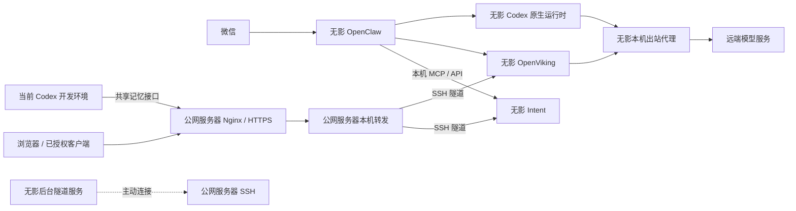

# 个人工作环境：架构与部署清单

快照导出：2026-10-11；源清单更新：2026-10-11。用途：快速找到“服务在哪、负责什么、配置和数据在哪”，供离线参考及后续迁移使用。

当前维护版是 OpenViking 用户资源 `viking://~/resources/work-environment/architecture.md`；本文为其脱敏快照，不独立维护第二份当前状态。初始资料来自 2026-10-11 的部署核对和用户提供的信息，计划与实际部署分开记录。配置只记录位置，不包含密码、Token、私钥或原始配置内容。

查询和按已确认变化更新清单使用 `viking://~/skills/maintain-work-environment/SKILL.md`，仓库留有 [Skill 副本](../../skills/maintain-work-environment/SKILL.md)。先更新 OpenViking，再按需要导出快照并更新日期；[博客草稿](../../posts/cloud-workspace-from-phone.md)记录阶段性的工作方式。2026-10-11 已验证资源与 Skill 的检索和读取，以及清单定点编辑、回读；微信端自动触发尚未验收。不包含服务器巡检或定时监控。

## 机器与托管平台

| 位置 | 当前部署 | 作用与后续安排 |
| --- | --- | --- |
| 火山云公网服务器，上海，4 GB 内存 + 4 GB Swap | Nginx、SSH 隧道入口、OpenViking / Intent 本机转发、证书续期和既有出站代理；另有 Digital Self 的 PostgreSQL | 保留公网入口和其他项目数据库；已迁服务的旧数据作为切换前副本保留 |
| 阿里云无影，8 核 16 GB，Ubuntu 24.04.4，x86_64，无公网 IP | OpenClaw、Codex、OpenViking、Intent 及配套服务、Docker、Mihomo 出站代理、后台反向隧道；管理用户为 admin | 承接助手、共享记忆和任务服务；ChatGPT 桌面端尚未安装 |
| 当前 Codex 开发环境 | Intent、personal-site 等仓库的开发副本；OpenViking 客户端插件 | 当前代码操作入口；不是无影上的安装，迁移时另行安排 |
| GitHub | 项目代码、文章和文档 | 版本管理；不包含个人数据库、模型登录等完整运行状态 |
| Vercel | personal-site 网站 | 构建与发布博客；网站不部署在上述两台机器上 |

无影系统盘约 79 GB，初始盘点时可用约 60 GB。隧道已由 `wuying-tunnel.service` 接管，已启用开机自启并验证接管后的重新连接；管理账号已可经隧道登录。自启配置生效不等于完成整机重启验收。用户已确认无影云平台不自动关机或休眠；admin 桌面的空闲挂起已关闭，屏幕锁定保留。

## 当前连接关系

OpenClaw、OpenViking 和 Intent 已在无影运行；原服务器保留原有本机入口并转发到隧道，现有 HTTPS 地址和客户端连接无需改动。

- **公网路径**：HTTPS 443 → 原服务器 Nginx → 本机转发入口 → SSH 隧道 → 无影 Intent / OpenViking。
- **助手路径**：微信 → 无影 OpenClaw → Codex 执行；通过本机工具连接 Intent 和 OpenViking。
- **模型出站**：无影使用本机 Mihomo `127.0.0.1:7891`。SSH 反向隧道负责入站转发，不承担模型出站。

## 公网服务器：服务在哪里

| 服务 | 作用 / 管理入口 | 代码、配置和数据位置 |
| --- | --- | --- |
| Nginx / HTTPS | 网站及记忆服务的公网入口；`nginx.service` | 站点入口 `/etc/nginx/sites-enabled/intent`；记忆转发 `/etc/nginx/snippets/intent-openviking.conf`；证书目录 `/etc/letsencrypt/` |
| Intent 转发入口 | 保持原服务器 `127.0.0.1:3180` 入口；`intent-forward.socket` / `intent-forward.service` | 单元在 `/etc/systemd/system/`；转发至本机 `23180` 隧道端口；原 Intent 服务已停用 |
| OpenViking 转发入口 | 保持原服务器 `127.0.0.1:1933` 入口；`openviking-forward.socket` / `openviking-forward.service` | 单元在 `/etc/systemd/system/`；转发至本机 `21933` 隧道端口；原 Docker 容器已停止，数据留作迁移前副本 |
| Mihomo 出站代理 | 保留原机工具与下载使用的既有网络通路 | `mihomo-codex.service`：`/etc/mihomo-codex/config.yaml`，本机 7891；`mihomo.service`：`/etc/mihomo/config.yaml`，本机 7890 |
| SSH 隧道入口 | 接收无影主动建立的连接；专用用户 wuying-tunnel | `/etc/ssh/sshd_config` 末尾的 `managed wuying reverse tunnel` 块；授权公钥 `/etc/ssh/authorized_keys/wuying-tunnel` |
| 无影管理登录 | 从原服务器经 `127.0.0.1:22222` 登录无影 admin | 独立管理私钥 `/root/.ssh/wuying_admin_ed25519`，仅保留在原服务器；无影主机校验文件 `/root/.ssh/wuying_known_hosts` |
| Digital Self PostgreSQL | 既有其他项目数据库，与 Intent 的 SQLite 分开 | 容器 `digital-self-db-database-1`；Compose `/opt/digital-self/deployment/postgres.yaml`；Docker 数据卷 `digital-self-db_postgres_data` |

Digital Self 数据库本次仅确认容器和挂载归属，未检查业务数据，也不在已确定的迁移范围内。数据库访问规则和 TLS 文件在 `/opt/digital-self/deployment/`；迁移其数据时应按 PostgreSQL 的备份恢复方式处理。

两台机器的自定义 systemd 单元均在 `/etc/systemd/system/`。当前活动的配套定时器分工：

| 定时器 | 当前机器 | 作用 |
| --- | --- | --- |
| `intent-watch.timer` | 无影 | 扫描变化及到期关注，扫描本身不代表发送通知 |
| `intent-run-report.timer` | 无影 | 补交执行报告 |
| `intent-backup.timer` | 无影 | Intent 数据备份 |
| `intent-certbot-renew.timer` | 公网服务器 | HTTPS 证书续期 |

原服务器的 OpenClaw、Intent、微信桥接及已迁移定时器已停止并禁用，资源采样 `intent-resource-monitor.timer` 也已停止禁用，未迁入无影。当前自动判断与自动通知仍未作为常驻能力启用。微信消费者与任务后台职责只保留无影上的正式实例。

## 共享记忆与登录配置

| 配置 | 位置 / 当前值 | 作用 |
| --- | --- | --- |
| OpenViking 主配置 | 无影 `/srv/openviking/ov.conf` | 模型、存储与鉴权；包含私有 key |
| OpenViking 独立 Codex 登录 | 无影 `/srv/openviking/codex_auth.json` | 记忆整理所用 OAuth，由 OpenViking 自己刷新 |
| OpenClaw 访问记忆的 key | 无影 `/var/lib/arbor/.openclaw/openviking-secrets/personal.key` | OpenClaw 通过 SecretRef 读取 |
| Codex 客户端记忆连接 | 各客户端的 `~/.openviking/ovcli.conf` | 指向共享 OpenViking；安装新客户端时单独配置 |
| 整理模型 | `openai-codex / gpt-6-luna`，推理强度 low | 摘要与记忆整理；无影迁移后经本机代理完成一次虚构短调用，返回 OK（约 2.45 秒） |
| 向量模型 | `doubao-embedding-vision-251215`，1024 维，multimodal | 语义检索；保留现有模型与索引匹配 |

OpenClaw 的 Codex 登录与 OpenViking 的登录是两份独立凭据。服务进程正常不代表模型账号有可用额度；迁移时同时检查模型登录和出站网络。不能让新旧实例同时维护同一份刷新凭据。

无影版本记录：OpenViking 0.4.23、OpenClaw 2026.9.8、Codex 0.160.1、Node.js 24.21.0、Mihomo 1.19.30。迁移保留既有应用版本；升级前核对实际安装版本。

## 无影：服务、文件位置与连接

应用继续沿用原服务器路径，后续查配置和备份时以无影上的目录为当前版本。

| 服务 | 作用 / 管理入口 | 代码、配置和数据位置 |
| --- | --- | --- |
| OpenClaw | 承接微信、管理助手与工具；`openclaw-personal.service`，用户 arbor | 程序 `/opt/openclaw/current`；主配置 `/var/lib/arbor/.openclaw/openclaw.json`；状态与插件 `/var/lib/arbor/.openclaw/`；工作区 `/srv/openclaw/personal` |
| Codex | OpenClaw 使用的原生执行环境 | 入口 `/usr/local/bin/codex`；配置、会话、独立登录 `/var/lib/arbor/.codex/`，其中 `auth.json` 是私有凭据 |
| Intent | 原始输入、目标、项目、任务、资料及行动；`intent.service` | 当前代码链接 `/opt/intent/current` → `/opt/intent/releases/51d46ea`；环境配置 `/etc/intent/intent.env`；数据 `/var/lib/intent/intent.sqlite`；备份 `/var/lib/intent/backups/` |
| Intent 微信桥接 | 将可信入站消息交给 Intent；`intent-channel-bridge.service` | 代码 `/opt/intent/openclaw-channel/`；桥接配置 `/etc/intent/channel-bridge.json`；身份映射 `/var/lib/intent/channel-identities.json` |
| Intent 执行报告 | 将助手执行结果回报 Intent | 配套文件 `/opt/intent/openclaw-runs/`；部署脚本与私有维护资料 `/opt/intent/deployment/` |
| Intent 助手凭据与反馈身份 | MCP、报告、GitHub 反馈使用；仅记录位置 | `/etc/intent-agent/agent.key`、`github-feedback.token`、`feedback-identities.json`；目录与文件采用 root:arbor 受限权限 |

代理与启动依赖覆盖配置统一放在 `/etc/systemd/system/` 下对应服务的 `.service.d/` 目录，Docker、OpenClaw 和 Intent 的覆盖配置随迁移保留。

| 项目 | 位置 | 当前状态 |
| --- | --- | --- |
| 管理用户目录 | `/home/admin/` | 已使用 |
| 隧道私钥与公钥 | `/home/admin/.ssh/wuying_tunnel` 和同名 `.pub` | 已生成；私钥留在无影 |
| 可信服务器公钥 | `/home/admin/.ssh/wuying_server_known_hosts` | 已配置严格校验 |
| 管理登录授权 | `/home/admin/.ssh/authorized_keys` | 保存原服务器独立管理公钥；限制来源 `127.0.0.1` 并设置 `restrict` |
| 隧道后台服务 | `/etc/systemd/system/wuying-tunnel.service` | enabled / active；已接管前台连接并验证重新连接 |
| Mihomo 出站代理 | `/usr/local/bin/mihomo`；`/etc/mihomo-codex/config.yaml`；`/etc/mihomo/provider.yaml` | `mihomo-codex.service` enabled / active，仅本机 7891；配置和 provider 文件含私有信息 |
| 命令行与桌面代理 | `/usr/local/bin/with-proxy`；admin 的 GNOME 手动代理设置 | 命令行按需使用包装器；桌面已配置手动代理 |
| Docker | Docker 29.1.3 / Compose 2.40.3 | 承载 OpenViking |
| OpenViking | Compose `/opt/openviking/compose.yaml`；配置、凭据和数据 `/srv/openviking/`，挂到容器 `/app/.openviking` | 容器 `openviking`，0.4.23，保留原镜像 digest；健康、现有 MCP 读取与语义检索已验证 |
| ChatGPT 桌面端、项目代码 | 待安装和安排 | 不能将计划目录当成已存在目录 |

| 原服务器回环端口 | 无影目标 | 用途 / 当前验证 |
| --- | --- | --- |
| `127.0.0.1:22222` | `127.0.0.1:22` | 维护 SSH，已验证管理账号登录 |
| `127.0.0.1:21933` | `127.0.0.1:1933` | OpenViking 已切换，承接现有记忆接口流量 |
| `127.0.0.1:23180` | `127.0.0.1:3180` | Intent 已切换，承接现有网页和 API 流量 |

三个端口仅在原服务器本机监听。隧道账号不能执行命令，只允许指定转发；它与登录无影的管理账号分开。主机身份、公钥授权和业务 API 鉴权分别保留。

## 代码与文档在哪里

| 内容 | 当前来源 / 位置 |
| --- | --- |
| Intent 代码与产品部署说明 | `cytlabs/intent`；当前开发端 `/root/code/intent`；产品运行说明在该仓库 `docs/operations/` |
| personal-site 网站和博客 | `cytlabs/personal-site`；当前开发端已有 `/root/code/personal-site` 副本，独立任务可能使用其他工作副本 |
| 博客源稿 | personal-site 的 `posts/cloud-workspace-from-phone.md`，目前为草稿 |
| 本架构清单 | OpenViking 用户资源 `viking://~/resources/work-environment/architecture.md`；仓库文件是脱敏快照 |
| 架构维护 Skill | `viking://~/skills/maintain-work-environment/SKILL.md`；2026-10-11 已安装并验证检索、读取。客户端需接入同一用户并支持技能发现；微信端自动触发尚未验收 |
| OpenClaw 使用的项目 Skill | 无影 `/srv/openclaw/personal/skills/`；Intent 对应 Skill 随产品部署同步 |

GitHub 保存可版本化的代码与文档；服务器数据库、OAuth、微信登录和 API key 单独保存，不能把代码仓库当成完整环境备份。

## 后续迁移与维护规则

隧道后台化、无影出站代理、OpenViking、OpenClaw 和 Intent 的服务迁移已完成，公网服务器保留 HTTPS 入口。ChatGPT 桌面端及日常开发仓库仍待安装和安排；微信真实收发、整机重启后的完整恢复按实际验收结果另行记录。

本次已验证无影 OpenClaw Gateway 健康、微信渠道 configured / running；原 HTTPS 网页、API 登录与对象读取返回 200，无效凭据返回 401；Intent 数据库切换前 SHA256 一致、20 张表及 SQLite `quick_check` 通过，新机备份已生成且可通过 `quick_check`。Intent MCP 已用 arbor 账号及 Agent 凭据初始化，发现 22 个工具并完成 `capture_list` 只读查询；执行报告服务成功结束。GitHub 反馈凭据已随迁移保留，本轮未提交真实 Issue。渠道运行状态不等于已经完成真实微信收发验收；用户浏览器普通试用、整机重启和长时间运行仍待验证。

原服务器迁移前备份目录为 `/root/wuying-migration-20261011/`：OpenViking 一致性备份 `openviking-before.tar.gz`；停止旧服务后保存的 OpenClaw / Intent 一致性备份 `apps-before.tar`；Intent 助手独立凭据备份 `intent-agent-config.tar.gz`。原机停止服务后留下的应用数据和备份均是切换前恢复点，不包含无影接受的新写入。

迁移时重点核对五项：**代码版本、持久数据、配置与凭据、外部依赖、后台服务和定时器**。微信消费者只保留一个正式实例；向量索引与向量模型保持匹配；新机接受写入后不能直接退回旧数据。

以后每次迁移或新增服务，更新 OpenViking 清单对应的机器、服务、路径和连接关系，再按需要导出本文。只有验证过的部署才写进“当前”；计划位置保留待迁移标记，不再积累终端输出和操作流水账。

手机使用方面：ChatGPT Linux 预览版支持这台无影的系统，但官方 Remote 文档列出的桌面主机仍是 Mac/Windows。手机直连这台 Linux 的 Codex 尚不能当成已支持；无影客户端访问桌面是独立入口。来源：[Linux 桌面端](https://learn.chatgpt.com/docs/linux/linux-app)、[Remote 连接](https://learn.chatgpt.com/docs/remote-connections)。
