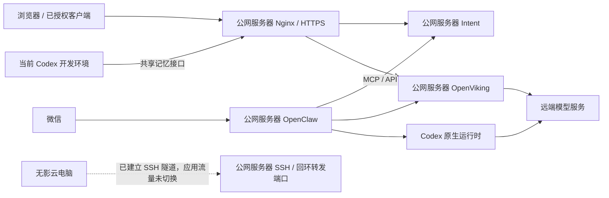

# 个人工作环境：架构与部署清单

快照导出：2026-10-11；源清单更新：2026-10-11。用途：快速找到“服务在哪、负责什么、配置和数据在哪”，供离线参考及后续迁移使用。

当前维护版是 OpenViking 用户资源 `viking://~/resources/work-environment/architecture.md`；本文为其脱敏快照，不独立维护第二份当前状态。初始资料来自 2026-10-11 的部署核对和用户提供的信息，计划与实际部署分开记录。配置只记录位置，不包含密码、Token、私钥或原始配置内容。

查询和按已确认变化更新清单使用 `viking://~/skills/maintain-work-environment/SKILL.md`，仓库留有 [Skill 副本](../../skills/maintain-work-environment/SKILL.md)。先更新 OpenViking，再按需要导出快照并更新日期；[博客草稿](../../posts/cloud-workspace-from-phone.md)记录阶段性的工作方式。2026-10-11 已验证资源与 Skill 的检索和读取，以及清单定点编辑、回读；微信端自动触发尚未验收。不包含服务器巡检或定时监控。

## 机器与托管平台

| 位置 | 当前部署 | 作用与后续安排 |
| --- | --- | --- |
| 火山云公网服务器，上海，4 GB 内存 + 4 GB Swap | Nginx、OpenClaw、Codex、OpenViking、Intent 及配套服务；另有 Digital Self 的 PostgreSQL | 当前承接正式业务；计划保留公网入口，逐项迁出部分后端 |
| 阿里云无影，8 核 16 GB，Ubuntu 24.04.4，x86_64，无公网 IP | SSH 服务、前台反向隧道；管理用户为 admin | 计划成为日常桌面与开发环境；应用服务尚未迁入，ChatGPT 桌面端尚未安装 |
| 当前 Codex 开发环境 | Intent、personal-site 等仓库的开发副本；OpenViking 客户端插件 | 当前代码操作入口；不是无影上的安装，迁移时另行安排 |
| GitHub | 项目代码、文章和文档 | 版本管理；不包含个人数据库、模型登录等完整运行状态 |
| Vercel | personal-site 网站 | 构建与发布博客；网站不部署在上述两台机器上 |

无影系统盘约 79 GB，盘点时可用约 60 GB。隧道已经验证公钥认证、回环监听和无影 SSH 握手；仍以前台进程运行，自启与断线恢复未验收。

## 当前连接关系

图中的无影虚线表示机器间隧道连接；当前 Nginx 仍然连接原服务器上的应用。

- **当前公网路径**：HTTPS 443 → Nginx → 原服务器本机 Intent / OpenViking。
- **当前助手路径**：微信 → OpenClaw → Codex 执行；通过工具访问 Intent 和 OpenViking。
- **迁移后目标路径**：HTTPS 443 → 原服务器 Nginx → 回环转发端口 → SSH 隧道 → 无影后端。
- **模型出站**：通过既有出站代理连接模型服务；反向隧道不自动提供这个能力，迁移时需单独核对。

## 公网服务器：服务在哪里

| 服务 | 作用 / 管理入口 | 代码、配置和数据位置 |
| --- | --- | --- |
| Nginx / HTTPS | 网站及记忆服务的公网入口；`nginx.service` | 站点入口 `/etc/nginx/sites-enabled/intent`；记忆转发 `/etc/nginx/snippets/intent-openviking.conf`；证书目录 `/etc/letsencrypt/` |
| OpenClaw | 承接微信、管理助手与工具；`openclaw-personal.service`，用户 arbor | 程序 `/opt/openclaw/current`；主配置 `/var/lib/arbor/.openclaw/openclaw.json`；状态与插件 `/var/lib/arbor/.openclaw/`；工作区 `/srv/openclaw/personal` |
| Codex | OpenClaw 使用的原生执行环境 | 入口 `/usr/local/bin/codex`；配置、会话、独立登录 `/var/lib/arbor/.codex/`，其中 `auth.json` 是私有凭据 |
| OpenViking | 共享记忆、资料整理与检索；Docker 容器 `openviking` | Compose `/opt/openviking/compose.yaml`；完整持久化目录 `/srv/openviking/`，挂到容器 `/app/.openviking` |
| Intent | 原始输入、目标、项目、任务、资料及行动；`intent.service` | 当前代码链接 `/opt/intent/current` → `/opt/intent/releases/51d46ea`；环境配置 `/etc/intent/intent.env`；数据 `/var/lib/intent/intent.sqlite`；备份 `/var/lib/intent/backups/` |
| Intent 微信桥接 | 将可信入站消息交给 Intent；`intent-channel-bridge.service` | 代码 `/opt/intent/openclaw-channel/`；桥接配置 `/etc/intent/channel-bridge.json`；身份映射 `/var/lib/intent/channel-identities.json` |
| Intent 执行报告 | 将助手执行结果回报 Intent | 配套文件 `/opt/intent/openclaw-runs/`；部署脚本与私有维护资料 `/opt/intent/deployment/` |
| Mihomo 出站代理 | 为 Codex / 模型请求及下载提供已有网络通路 | `mihomo-codex.service`：`/etc/mihomo-codex/config.yaml`，本机 7891；`mihomo.service`：`/etc/mihomo/config.yaml`，本机 7890 |
| SSH 隧道入口 | 接收无影主动建立的连接；专用用户 wuying-tunnel | `/etc/ssh/sshd_config` 末尾的 `managed wuying reverse tunnel` 块；授权公钥 `/etc/ssh/authorized_keys/wuying-tunnel` |
| Digital Self PostgreSQL | 既有其他项目数据库，与 Intent 的 SQLite 分开 | 容器 `digital-self-db-database-1`；Compose `/opt/digital-self/deployment/postgres.yaml`；Docker 数据卷 `digital-self-db_postgres_data` |

Digital Self 数据库本次仅确认容器和挂载归属，未检查业务数据，也不在已确定的迁移范围内。数据库访问规则和 TLS 文件在 `/opt/digital-self/deployment/`；迁移其数据时应按 PostgreSQL 的备份恢复方式处理。

自定义 systemd 单元在 `/etc/systemd/system/`。当前活动的配套定时器为：

| 定时器 | 作用 |
| --- | --- |
| `intent-watch.timer` | 扫描变化及到期关注，扫描本身不代表发送通知 |
| `intent-run-report.timer` | 补交执行报告 |
| `intent-backup.timer` | Intent 数据备份 |
| `intent-certbot-renew.timer` | HTTPS 证书续期 |
| `intent-resource-monitor.timer` | 资源采样 |

当前自动判断与自动通知仍未作为常驻能力启用。迁移时需一并盘点这些后台职责，避免新旧两台机器同时处理同一批数据或消息。

## 共享记忆与登录配置

| 配置 | 位置 / 当前值 | 作用 |
| --- | --- | --- |
| OpenViking 主配置 | `/srv/openviking/ov.conf` | 模型、存储与鉴权；包含私有 key |
| OpenViking 独立 Codex 登录 | `/srv/openviking/codex_auth.json` | 记忆整理所用 OAuth，由 OpenViking 自己刷新 |
| OpenClaw 访问记忆的 key | `/var/lib/arbor/.openclaw/openviking-secrets/personal.key` | OpenClaw 通过 SecretRef 读取 |
| Codex 客户端记忆连接 | 各客户端的 `~/.openviking/ovcli.conf` | 指向共享 OpenViking；安装新客户端时单独配置 |
| 整理模型 | `openai-codex / gpt-6-luna`，推理强度 low | 摘要与记忆整理；本轮已通过一次短调用 |
| 向量模型 | `doubao-embedding-vision-251215`，1024 维，multimodal | 语义检索；保留现有模型与索引匹配 |

OpenClaw 的 Codex 登录与 OpenViking 的登录是两份独立凭据。服务进程正常不代表模型账号有可用额度；迁移时同时检查模型登录和出站网络。不能让新旧实例同时维护同一份刷新凭据。

版本记录：OpenViking 0.4.23、服务器 Codex 0.160.1；OpenClaw 既有部署记录为 2026.9.8。升级或迁移前核对实际安装版本。

## 无影：文件位置与预留连接

| 项目 | 位置 | 当前状态 |
| --- | --- | --- |
| 管理用户目录 | `/home/admin/` | 已使用 |
| 隧道私钥与公钥 | `/home/admin/.ssh/wuying_tunnel` 和同名 `.pub` | 已生成；私钥留在无影 |
| 可信服务器公钥 | `/home/admin/.ssh/wuying_server_known_hosts` | 已配置严格校验 |
| 隧道后台服务 | 计划为 `/etc/systemd/system/wuying-tunnel.service` | 尚未创建，当前隧道在终端前台运行 |
| OpenClaw / OpenViking / Intent | 尚无确认的无影部署目录 | 仍在原服务器；迁入后填写实际路径 |
| ChatGPT 桌面端、项目代码 | 待安装和安排 | 不能将计划目录当成已存在目录 |

| 原服务器回环端口 | 无影目标 | 用途 / 当前验证 |
| --- | --- | --- |
| `127.0.0.1:22222` | `127.0.0.1:22` | 维护 SSH，已收到握手，尚未验证管理账号登录 |
| `127.0.0.1:21933` | `127.0.0.1:1933` | OpenViking 迁移后使用，应用未切换 |
| `127.0.0.1:23180` | `127.0.0.1:3180` | Intent 迁移后使用，应用未切换 |

三个端口仅在原服务器本机监听。隧道账号不能执行命令，只允许指定转发；它与未来登录无影的管理账号分开。主机身份、公钥授权和业务 API 鉴权分别保留。

## 代码与文档在哪里

| 内容 | 当前来源 / 位置 |
| --- | --- |
| Intent 代码与产品部署说明 | `cytlabs/intent`；当前开发端 `/root/code/intent`；产品运行说明在该仓库 `docs/operations/` |
| personal-site 网站和博客 | `cytlabs/personal-site`；当前开发端已有 `/root/code/personal-site` 副本，独立任务可能使用其他工作副本 |
| 博客源稿 | personal-site 的 `posts/cloud-workspace-from-phone.md`，目前为草稿 |
| 本架构清单 | OpenViking 用户资源 `viking://~/resources/work-environment/architecture.md`；仓库文件是脱敏快照 |
| 架构维护 Skill | `viking://~/skills/maintain-work-environment/SKILL.md`；2026-10-11 已安装并验证检索、读取。客户端需接入同一用户并支持技能发现；微信端自动触发尚未验收 |
| OpenClaw 使用的项目 Skill | 原服务器 `/srv/openclaw/personal/skills/`；Intent 对应 Skill 随产品部署同步 |

GitHub 保存可版本化的代码与文档；服务器数据库、OAuth、微信登录和 API key 单独保存，不能把代码仓库当成完整环境备份。

## 后续迁移与维护规则

计划顺序：先完成隧道后台运行与恢复验证，再迁 OpenViking、OpenClaw，最后按需要迁 Intent。公网服务器继续保留 HTTPS 入口；服务切换前不改变现有 Nginx upstream。

迁移时重点核对五项：**代码版本、持久数据、配置与凭据、外部依赖、后台服务和定时器**。微信消费者只保留一个正式实例；向量索引与向量模型保持匹配；新机接受写入后不能直接退回旧数据。

以后每次迁移或新增服务，更新 OpenViking 清单对应的机器、服务、路径和连接关系，再按需要导出本文。只有验证过的部署才写进“当前”；计划位置保留待迁移标记，不再积累终端输出和操作流水账。

手机使用方面：ChatGPT Linux 预览版支持这台无影的系统，但官方 Remote 文档列出的桌面主机仍是 Mac/Windows。手机直连这台 Linux 的 Codex 尚不能当成已支持；无影客户端访问桌面是独立入口。来源：[Linux 桌面端](https://learn.chatgpt.com/docs/linux/linux-app)、[Remote 连接](https://learn.chatgpt.com/docs/remote-connections)。
