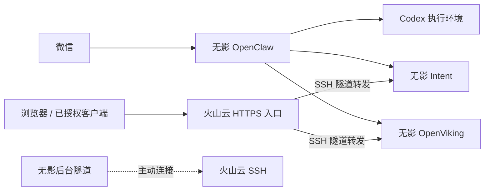

我希望把工作环境逐步搬到线上。出门只带手机，也能提出任务、补充要求和检查结果；需要完整桌面时，就进入云电脑继续操作。代码、工具和资料留在固定的环境里，不必随着手边设备变化而重新配置。

为此，我把已有的火山云服务器和新买的阿里云无影云电脑接在了一起。前者有公网 IP，后者是 8 核、16 GB 内存的 Ubuntu 云电脑，没有公网 IP，但可以长期在线。

截至 **2026 年 10 月 11 日**，OpenClaw、OpenViking 和 Intent 已经迁到无影，微信与网页的基本使用已经试过，备份和资源监控也已配置。这套环境还没有完成所有桌面工具和开发项目的迁入，“只带手机完成所有工作”仍是接下来要用真实工作检验的目标。

## 手机是入口，云端负责执行和保存

我准备通过三个入口处理工作。

**微信助手**负责随手记录、查询状态和接收明确指令。它由 OpenClaw 承接，通过 MCP 或其他工具操作项目。例如，查询 Intent 中的任务，或者按我的指令更新任务状态，都不需要先打开网页。

**手机 ChatGPT / Codex**用于在账号和客户端支持的范围内发起任务、查看结果和补充要求。具体任务在哪台机器执行，取决于它接入的环境；登录同一个账号，并不等于自动连上了我的云电脑。

**无影桌面**用于需要亲自操作图形界面的工作。遇到不方便通过对话完成的事情，可以进入完整桌面继续处理。我也计划把常用桌面工具和开发项目逐步搬过去。

这三个入口各有用处。代码由 Git 管理，正式任务状态由 Intent 保存，已经接入的助手通过 OpenViking 使用共享记忆。每个入口都需要实际接通相应的工具和权限。

## 公网服务器和云电脑怎样分工

| 位置 | 当前承担的工作 |
| --- | --- |
| 火山云服务器 | HTTPS 公网入口、反向隧道接入、应用转发、无影的异机备份副本、两机资源监控；另有原来的其他项目数据库 |
| 无影云电脑 | OpenClaw、Codex、OpenViking、Intent、出站代理、后台反向隧道和本地备份 |
| GitHub / Vercel | 代码与文章版本管理、个人网站托管 |

公网服务器提供固定的访问入口，无影承担助手和应用运行。个人网站继续使用原有的 GitHub 与 Vercel 发布链路。

无影没有公网 IP，所以由它主动向火山云服务器建立 SSH 反向隧道。服务器收到网页或共享记忆接口请求后，再沿这条连接转发到无影。转发端口只监听服务器本机，对外访问继续经过 HTTPS 和业务鉴权。这个连接方式使用的是 OpenSSH 的远程端口转发能力。[OpenSSH 说明](https://man.openbsd.org/ssh#R)

反向隧道负责从公网入口访问无影，出站代理负责无影访问模型服务等外部资源。它们解决的是两个方向的问题，需要分别配置。

迁移完成后，原服务器上的对应旧应用已经停用，微信消费者只保留无影上的正式实例。访问入口没有变，背后真正运行服务的机器换成了无影。

## 几个服务各自管理什么

| 服务 | 职责 |
| --- | --- |
| OpenClaw | 承接微信，组织助手、模型、工具和会话 |
| Codex | 执行开发及其他已授权工作 |
| Intent | 管理原始输入、目标、项目、任务、资料和实际行动 |
| OpenViking | 保存和检索共享记忆、知识资料与 Skill |

我希望助手能够接着之前的事情做下去，而不是每换一个客户端，就重新解释一次背景。但共享记忆并不替代项目本身的数据：任务是否完成，以 Intent 为准；当前代码是什么，以仓库为准。

OpenViking 会归档对话，并提炼、更新长期记忆。读取时先通过摘要和概览定位，再按需加载内容；历史记录仍可能持续增长，自动整理也不保证消除所有重复或过时信息。[记忆机制](https://blog.openviking.ai/post/openviking-coding-agent/)、[分层读取](https://docs.openviking.ai/en/concepts/03-context-layers)

因此，我也给主动维护的知识资料设了一个边界：只留下会影响以后查找、使用、迁移和恢复环境的信息。一次普通测试通过，或者再次确认服务已经停止，不需要反复追加成长期知识。这个维护规则约束的是助手怎样编辑资料，并不等于已经为所有自动记忆配置了清理策略。

## 部署清单放进知识库，博客说明工作方式

搭完环境后，一个很实际的问题是：服务到底在哪台机器上，配置和数据又放在哪里？如果只有聊天记录，下次迁移时还是得重新翻找。

我把这些信息放进 OpenViking 的个人知识库，维护一份当前架构清单，主要包含：

- 机器和服务的分工，以及它们之间的连接关系。
- 配置、持久数据、备份和恢复说明的位置。
- 后续维护必须知道的限制，例如新机产生新数据后不能直接启用旧副本。

另一个维护 Skill 规定助手如何查询和更新这份清单：先读现有内容，有实际变化才修改对应条目，不把每次操作都写成流水账。

网站保留这篇介绍架构和工作方式的文章。日常部署清单和维护 Skill 留在知识库里，不再向网站仓库同步副本。这样，公开文章和实际维护资料各有明确用途。

## 备份关键数据，接受恢复需要时间

工作都在线上之后，机器和磁盘就更不能成为数据的唯一落点。我的要求很简单：误删后能找回，云电脑无法使用或整台丢失后，能在其他机器恢复。个人使用可以接受停机，不需要为此搭一套持续接管的高可用系统。

备份范围也不必等同于整个系统盘。程序安装包、依赖、构建产物和普通缓存可以重新获取；需要优先保存的是我产生的内容，以及让这些内容能够恢复使用的配置和状态。

目前主要保留记忆与知识资料、会话、Intent 数据、自定义 Skill、必要配置和登录状态，排除可重新安装的程序与大部分缓存。登录状态即使恢复，也可能因过期而需要重新认证。

| 副本 | 时间（北京时间） | 保留方式 |
| --- | --- | --- |
| 无影本地备份 | 每天凌晨 4 点 | 最近 7 份成功快照，用于误删恢复 |
| 火山云异机副本 | 每天凌晨 4 点半拉取 | 最近 14 份成功副本，用于无影丢失后的恢复 |

凌晨 4 点以备份为优先，即使我还在使用，也允许短暂停止相关应用。程序先复制一致的数据，再恢复服务，随后压缩、加密和校验。备份之间独立保留历史，不把源目录的删除直接同步过去。

第一份压缩加密后的归档约 **35 MB**，两台机器都已保存，并通过解包、文件校验和数据库检查。这说明这份归档可以读取，不代表已经完成了一次从空白机器开始的完整恢复演练。恢复时仍需安装程序、核对账号与权限，并持有对应的解密密钥。

两份副本能覆盖单台机器丢失的情况，但不能覆盖两台机器及密钥同时丢失。后续若增加更独立的备份位置，再按实际需要调整。

## 低频监控，有问题再通知

这是一套个人工作环境，我不需要频繁收到“运行正常”的消息。

目前每 30 分钟检查两台机器的 CPU、内存、磁盘和连通性。一般异常连续两次出现才提醒，磁盘接近耗尽时可以单次告警；同一问题限制重复通知，恢复后再发恢复消息。通知复用现有微信 bot，资源采样和告警判断不调用模型。

这个安排也有边界：微信 bot 在无影上，无影完全离线时，它无法立刻向我发消息，只能等恢复后补报；监控主机本身离线时，也不能主动检查。当前的监控用于发现资源压力，不承担保证所有故障都能实时通知的职责。

## 接下来，用真实工作检验它

助手、记忆和任务服务已经搬过去，接下来还要配置桌面工具、迁入日常开发项目，并实际尝试从手机发起工作、查看结果，以及在需要时进入无影桌面继续操作。不同客户端的远程连接能力需要逐项确认，不能把计划中的入口写成已经打通。

我希望最终减少的是“必须回到某台电脑前才能继续”的限制。环境留在线上，手机处理随手的指令和确认，完整桌面处理需要亲自操作的部分。能不能成为日常工作方式，要看接下来的实际使用。
