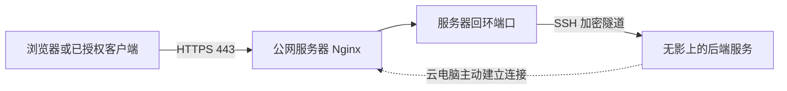

我最近买了一台无影云电脑：8 核、16 GB 内存，运行 Ubuntu 24.04，打算让它长期在线。

我已经有一台带公网 IP 的服务器，上面运行着个人助手 OpenClaw、共享记忆服务 OpenViking，以及正在开发的 Intent。现在，我想把一部分工作迁到云电脑，让它逐渐成为日常工作环境。

我希望达到的状态是：出门只带手机，也能提出任务、补充要求、查看结果；需要完整桌面时，再通过无影进入同一台云电脑。项目文件、开发工具和工作记录留在线上，工作可以接着进行。

这件事还在搭建中。本文记录截至 **2026 年 10 月 11 日**的实际进展，后面会继续补充迁移和使用结果。文末的维护说明与仓库里的 `docs/operations/cloud-workspace.md` 配套使用，后者保留完整配置、检查命令和回退步骤。

## 我希望怎样用手机工作

我设想了三种入口。

第一种是微信。现有的微信助手由 OpenClaw 承接，可以通过接入的工具查询和操作项目。适合随手记录、查询状态和给出明确指令。

第二种是手机里的 ChatGPT / Codex。在账号和设备支持的范围内，我希望用它发起工作、查看代码修改、回答执行过程中需要我决定的问题。执行环境放在线上，手机负责与它交互。

第三种是无影桌面。遇到图形界面、页面检查或需要亲自操作的事情，就进入云电脑的桌面处理。后续我也计划在这台云电脑上安装 ChatGPT 桌面端。

三种入口不会天然拥有相同的文件、权限和会话。代码通过 Git 管理，任务状态保存在 Intent，已接入的助手通过 OpenViking 使用共享记忆。新安装一个客户端，还需要单独配置相应连接，不能因为用了同一个账号，就假设全部上下文已经同步。

## 两台机器分别负责什么

原服务器有公网 IP，适合保留对外访问入口。云电脑有更大的内存和完整桌面，适合放开发环境和后续迁入的服务。

| 位置 | 目前状态 | 计划承担的工作 |
| --- | --- | --- |
| 公网服务器 | OpenClaw、OpenViking、Intent 仍在这里运行 | 保留 HTTPS、Nginx 和隧道入口，逐步转移后端负载 |
| 无影云电脑 | 已核对 Ubuntu 24.04.4、x86_64；系统盘约 79 GB，检查时可用约 60 GB | 承载开发工具、项目文件、ChatGPT 桌面端，以及经过验证后迁入的服务 |
| 手机 | 用作交互入口 | 使用微信、支持的 Codex 功能和无影桌面入口处理工作 |

云电脑没有公网 IP，并不妨碍它承接来自旧服务器的请求。前提是它能主动连接旧服务器，且隧道保持在线。

计划中的网站访问路径是：



这张图描述的是后续切换目标。当前 Nginx 仍访问原服务器上的服务，尚未切到无影。

## 没有公网 IP，怎样建立连接

我采用的是 SSH 反向隧道。无影主动连接服务器的 SSH 端口，在服务器的回环地址上建立几个转发入口。Nginx 以后可以访问这些本机入口，请求再沿加密连接送到无影。这是 OpenSSH 自带的远程端口转发能力。[OpenSSH 说明](https://man.openbsd.org/ssh#R)

这一步的实际操作顺序是：

1. 在无影检查系统版本、CPU 架构、可用磁盘和 SSH 客户端。
2. 在无影生成一对专用 Ed25519 密钥。只把公钥交给服务器，私钥留在无影。
3. 在服务器创建专用的 `wuying-tunnel` 账号，禁止密码登录和命令执行，只允许指定的反向端口转发。
4. 通过已有可信管理连接读取服务器公钥，放进无影专用的 `known_hosts` 文件。
5. 备份并校验服务器 SSH 配置，确认原管理账号的有效配置没有改变，再平滑重载。
6. 从无影启动隧道，检查认证日志、监听地址和实际后端响应。

目前预留了三个映射：

| 公网服务器上的监听地址 | 无影上的目标 | 用途 |
| --- | --- | --- |
| `127.0.0.1:22222` | `127.0.0.1:22` | 后续维护云电脑的 SSH 通道 |
| `127.0.0.1:21933` | `127.0.0.1:1933` | OpenViking 迁移后的服务通道 |
| `127.0.0.1:23180` | `127.0.0.1:3180` | Intent 迁移后的服务通道 |

这些端口只监听服务器本机，不是新开的公网服务。公网 HTTPS 和业务鉴权仍由现有入口承担；隧道加密也不替代后端的身份校验。

## 第一次连接失败，问题出在公钥文件权限

第一次执行连接命令，终端返回了：

```text
Permission denied (publickey).
```

查看服务器日志后发现，问题不是公钥不匹配，而是 SSH 无法读取这个账号的公钥文件。助手在配置时把文件设成了 `root:root 0600`，只有 root 能读；认证过程中需要以隧道用户身份读取，因此被拒绝。

修复是把这个由 root 管理的**公钥授权文件**改成 `0644`：账号可以读取，仍然只有 root 可以修改。随后用隧道账号验证文件可读，并重新执行 SSH 配置检查。

这个结论只适用于这里的公钥文件。无影上的私钥仍应保持 `0600`，不能照着改成公开可读。

重试后，终端保持运行，没有报错。服务器记录了公钥认证成功，三个端口都只监听 `127.0.0.1`；通过维护端口，也读到了无影 SSH 的握手信息。这证明了隧道连接与维护端口的转发，但还没有验证无影的管理登录，也不能据此认定三个后端都已可用：应用服务尚未迁移，必须分别检查。

这次故障也说明，记录一条“连接命令”远远不够。以后排错需要知道文件由谁持有、谁必须读取、预期权限是什么，以及去哪里看拒绝原因。

## 长期在线还需要哪些工作

现在的隧道在终端前台运行，关闭窗口或重启云电脑后不能指望它自动恢复。下一步要把它交给 systemd，配置开机启动、连接保活和失败后的重连，再实际验证断线、重启后的行为。

无影自身也有断连和休眠策略。准备让它长期运行，就要检查这些设置及套餐计费方式；不能仅凭“买了云电脑”推断它会一直在线。阿里云提供了相关策略设置说明。[无影断连定时策略](https://help.aliyun.com/zh/edsp/user-guide/set-scheduled-task-upon-disconnection)

服务迁移计划先从 OpenViking 开始，再处理 OpenClaw，最后按需要迁移 Intent。每一步都先备份并验证恢复，再切换访问入口。尤其是微信助手，切换时只能保留一个正式消息处理实例，避免新旧两台机器同时消费和回复。

## 模型账号、记忆和服务器运行是不同的问题

这轮搭建前，我还遇到了旧 Codex 账号订阅到期、需要更换登录的问题。

检查时，OpenClaw 和 OpenViking 的进程实际仍在运行。服务健康不代表模型调用成功，所以排查时需要分别看进程、服务接口、登录凭据和真实模型请求。

当前部署里，OpenClaw 使用服务账号的 Codex 登录，OpenViking 维护自己独立的 Codex OAuth 凭据。这次两边分别完成了新账号的设备登录，没有复制同一份可刷新凭据让它们共同维护。

OpenViking 的工作又分为两部分：向量模型负责检索表示，语言模型负责摘要和记忆整理。现有豆包向量模型和 1024 维索引保持不变；整理模型换成新账号实际可用的 GPT-6-Luna，并设置低推理强度。

一次短的虚构中文材料测试成功返回了结构化结果，区分了偏好、计划和“尚未完成”。这足以确认该调用路径可用，还不足以证明复杂、长期记忆的质量已经经过完整评估。模型在远端运行，这台 16 GB 云电脑承担的是客户端、服务和数据处理，并非在本机运行大模型。

## Linux 桌面端与手机远程连接，要分别验证

截至本文核对日期，OpenAI 官方提供 ChatGPT Linux 桌面预览版，支持 Ubuntu 24.04 和 x64。我的云电脑符合这两项条件，实际安装与桌面体验仍待验证；Linux 预览版也尚不支持文档所述的 Computer Use 桌面控制能力。[Linux 官方安装说明](https://learn.chatgpt.com/docs/linux/linux-app)

另一个容易混淆的地方是：能安装 Linux 桌面端，不代表手机 Codex 就能把这台 Linux 电脑当成远程主机。当前官方 Remote 文档列出的桌面主机是 Mac 和 Windows，不能把 Linux 的手机直连写成已经支持或已经打通。[远程连接说明](https://learn.chatgpt.com/docs/remote-connections)

因此，我会分别验证手机里的 Codex Cloud 或受支持连接，以及通过无影客户端进入 Linux 桌面的操作体验。两种入口使用的执行环境可能不同，文件和凭据也需要各自配置。

## 我会如何继续维护这份记录

目前已完成环境确认、专用密钥与账号配置、首次认证故障修复，以及服务器侧的隧道监听验证。服务迁移、隧道开机自启、重启恢复、ChatGPT 桌面安装和完整手机工作流程仍在后续队列中。

我会在每次改动后留下四项记录：改了什么、为什么改、怎样验证、出问题怎样退回。涉及配置时，补充文件路径、属主和权限；涉及迁移时，补充备份位置、恢复步骤和当前实际承接流量的机器。

完整命令维护在同一仓库的 `docs/operations/cloud-workspace.md`。真实公网地址、主机公钥、账号凭据和私人数据不放进文章；维护者需要在私有清单中保存对应关系。

接下来最有价值的检验，是挑一项真实工作：只用手机提出要求，在线上完成修改和测试，再由我检查结果。遇到必须操作桌面的环节，就通过无影接着做，并把卡住的地方补进这份记录。
