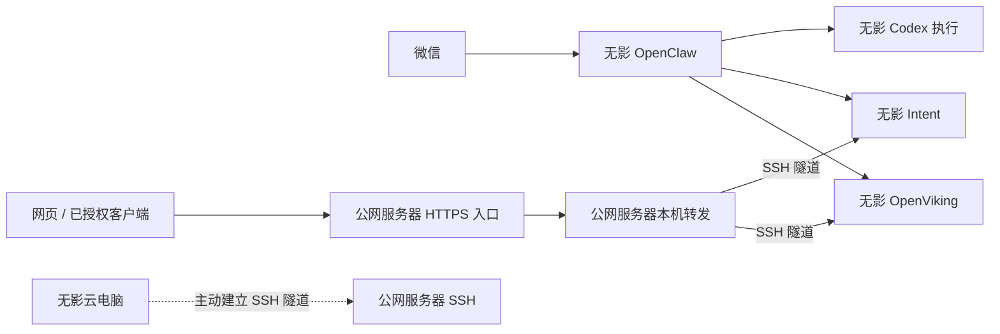

我希望把工作环境逐步搬到线上。出门只带手机，也能提出任务、补充要求和检查结果；需要完整桌面时，就进入云电脑继续操作。代码、工具和工作资料留在稳定的环境里，不必随着手边设备变化而重新配置。

现在我有一台带公网 IP 的服务器，又买了一台 8 核、16 GB 内存的无影云电脑。云电脑运行 Ubuntu 24.04，没有公网 IP，我打算让它长期在线，逐渐成为日常工作环境。

这套环境仍在搭建中。以下是 **2026 年 10 月 11 日**的架构记录，助手、共享记忆和任务服务已迁入无影，日常桌面工具仍在继续配置。

## 手机是入口，云端负责执行和保存

我准备通过三个入口处理工作。

**微信助手**负责随手记录、查询状态和接收明确指令。它由 OpenClaw 承接，通过接入的工具操作项目。

**手机 ChatGPT / Codex**用于在账号和设备支持的范围内发起任务、查看修改和回答执行过程中需要我决定的问题。任务在哪台机器执行，要看选择的是云端环境还是受支持的远程主机。

**无影桌面**用于需要亲自操作图形界面的工作。我计划在上面安装 ChatGPT 桌面端，并把常用项目和开发工具放到这台电脑上。

这些入口需要各自接入文件和服务。代码由 Git 管理，正式任务状态由 Intent 保存，已接入的助手通过 OpenViking 使用共享记忆；同一个账号不会自动让所有客户端拥有相同的工作环境。

## 公网服务器和云电脑怎样分工

| 位置 | 当前承担的工作 | 后续安排 |
| --- | --- | --- |
| 公网服务器 | Nginx、公网 HTTPS、反向隧道接入和应用转发；另有其他项目数据库 | 继续提供固定访问入口 |
| 无影云电脑 | OpenClaw、Codex、OpenViking、Intent、本机出站代理、后台反向 SSH 隧道 | 继续安装桌面和日常开发工具 |
| GitHub / Vercel | 代码与文章版本管理 / 个人网站托管 | 继续沿用；个人网站没有部署在上述两台机器上 |

公网服务器提供一个稳定的访问地址。无影提供更大的内存和完整桌面，适合承载日常开发环境。这样，换一台手机或临时借用电脑时，我仍然可以回到同一套工作资料和工具。

无影没有公网 IP，所以由它主动向原服务器建立 SSH 反向隧道。原服务器收到网页和共享记忆接口请求后，已经可以通过这条加密连接转发到无影。转发入口只监听服务器本机，公网访问继续经过 HTTPS 和业务鉴权。[OpenSSH 说明](https://man.openbsd.org/ssh#R)

## 工作环境里的几个核心服务

| 服务 | 作用 | 当前部署位置 |
| --- | --- | --- |
| OpenClaw | 微信助手的运行宿主，组织模型、工具和会话 | 无影云电脑 |
| Codex | 执行开发和其他已授权工作 | 无影上的 OpenClaw 使用原生 Codex；当前开发端也有独立环境 |
| OpenViking | 保存和检索共享记忆、知识资料与 Skill | 无影云电脑；HTTPS 入口留在公网服务器 |
| Intent | 管理原始输入、目标、项目、任务、资料和实际行动 | 无影云电脑 |
| Nginx | 统一承接网页及记忆接口的 HTTPS 访问 | 公网服务器 |

当前关系如下。助手和应用服务在无影运行，原有网页和记忆客户端仍通过相同的公网入口访问：

Nginx 保留在原服务器，通过隧道访问无影上的后端。无影另外安装了只监听本机的出站代理，供模型请求和需要代理的下载使用；反向隧道与出站代理负责不同方向的连接。

## 维护这套环境，需要知道东西放在哪里

我不想以后只记得“装过这个服务”，却不知道它运行在哪台机器、数据放在哪个目录。所以我把这些信息单独整理成了一份部署清单。

几个主要位置是：

| 内容 | 当前机器与位置 |
| --- | --- |
| OpenClaw 主配置与状态 | 无影 `/var/lib/arbor/.openclaw/` |
| 助手工作区与 Skill | 无影 `/srv/openclaw/personal/` |
| OpenViking 配置及持久化数据 | 无影 `/srv/openviking/`；Compose 在 `/opt/openviking/compose.yaml` |
| Intent 当前代码 | 无影 `/opt/intent/current` |
| Intent 配置、数据库和备份 | 无影 `/etc/intent/` 与 `/var/lib/intent/` |
| 无影连接凭据 | 无影 `/home/admin/.ssh/` |
| 博客文章 | personal-site 仓库 `posts/` |

完整的服务、路径和依赖关系维护在 OpenViking 的个人知识库中。以后问助手“OpenViking 的配置在哪”或“哪些服务还在原服务器上”，它可以先查这份资料。迁移或新增服务之后，再根据确认过的结果更新清单。

我还把这套查询和更新规则整理成了一个 Skill，保存在 OpenViking 同一个用户空间。知识库记录环境事实，Skill 说明助手怎样使用和维护这些事实。两者已经通过检索和读取验证；各个客户端仍需接入同一用户并支持技能发现，微信端自动触发还没有验收。这不包含服务器巡检，也不会因为文档里写了迁移计划就自行搬迁服务。

部署清单与维护 Skill 保存在 OpenViking。网站只保留这篇介绍架构和工作方式的文章，不承担日常运维知识库的职责。

配置路径可以记录，密码、API key、OAuth 和私人数据仍保存在受限的位置。迁移时也需要同时考虑服务账号、后台任务和外部连接，不能只复制代码目录。

## 下一步要完成什么

隧道已经交给后台服务管理，配置了开机自启，并验证了接管后的重新连接。OpenClaw、OpenViking 和 Intent 已在无影运行，原服务器的对应旧实例和已迁后台任务已经停止。服务迁移后，仍需用实际微信对话和日常工作检查体验，并在合适的维护时间验证整机重启恢复。

ChatGPT 桌面端也还没有安装。官方 Linux 预览版支持 Ubuntu 24.04 和 x64，但当前 Remote 文档列出的远程桌面主机仍是 Mac 和 Windows。因此，“在无影安装 Linux 客户端”与“手机 Codex 直接连接这台 Linux 主机”要分开看，后者不能写成已经可用。[Linux 安装说明](https://learn.chatgpt.com/docs/linux/linux-app)、[远程连接说明](https://learn.chatgpt.com/docs/remote-connections)

手机通过无影客户端进入桌面，是另一条独立路径。我会用真实工作逐步检验这套安排：发起任务、查看结果、必要时进入桌面接着操作，并在迁移或新增服务后更新部署清单。
